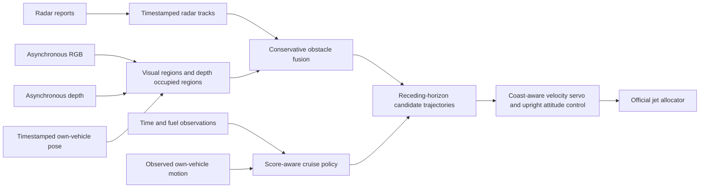

# Final-round radar and camera controller

> **Historical design:** the active source is now **OPEN_LANE_9** for
> `FINAL_SUBMISSION.simconf`. [OPEN_LANE_9.md](OPEN_LANE_9.md) describes
> the guarded launch, rolling predicted trajectories and station approach. This document's
> cruise policies and benchmark numbers describe earlier controller versions.
> Deploy `camera_viewer.py` alongside `Controller.py` for the OpenCV interface.

## Objective and scope

Maximize the official score by reaching the safe region with low damage, useful
speed, and fewer thruster corrections. This is an implementation candidate; only
repeated Space Teams PRO runs establish the achieved score. The existing protected
connection/helper prefix and the official STU4-Sim remain unchanged. Deployment
continues to use the self-contained `Controller.py`.

## Verified interfaces

The installed v0.55.0 `spaceteams/camera.pyi`, `CaptureImageProperties` stub, and
`spaceteams/camera/CameraCapture.h` document:

- Two physical cameras, `TopCamera` and `BottomCamera`, each supporting RGB and depth.
- `output_mode = st.OutputMode.Depth_cm`, `image.as_f32().Pixels`, row-major pixels,
  depth in centimetres, and a vertical field of view.
- RGB through `OutputMode.RGB_LDR_sRGB` and `image.as_RGB8().PixelsR/G/B`.
- `CaptureImage`, a caller-specified `CaptureID`, and `OnImageReceived` callbacks.
  These asynchronous interfaces are labelled deprecated but are present in the
  installed API. They avoid blocking the steering loop.
- Capture timestamps through `get_timestamp()`. Geometry uses +X forward, +Y right,
  +Z up, the camera body-frame pose, and the documented gimbal limits.

The depth mode's camera-forward interpretation must still be checked against a
known radar object during live calibration. A mismatch must be visible in telemetry;
camera pixels must never be used as world coordinates without projection and pose.

## Architecture



## Sensor processing

Capture small images on a bounded schedule, with one outstanding request per
camera and bounded retries. Register the callback before publishing the request
to avoid a fast-response race. Callbacks enqueue results; control-loop code does
the processing. Capture failure degrades camera coverage and is logged without
stopping radar navigation. Timed-out callbacks must not grow without bound.

Keep a short own-vehicle pose history. Match image capture timestamps to pose
history and reject unresolvable or stale images. Account for camera translation,
gimbal rotation, body rotation, pixel row/column, aspect ratio, and centimetre units.
Reset pending images and caches on simulation time reversal.

Depth regions become conservative local occupied volumes, including dark surfaces
and objects absent from radar. Do not infer free space outside the camera field of
view or behind visible surfaces. RGB regions supply visual bearings/contrast and
support associations; RGB alone cannot supply a metric obstacle range. RGB and
depth from different timestamps are not blindly combined pixel for pixel.

Radar remains the primary moving-object tracker. Matching depth occupancy may use
radar velocity, but a depth observation must not erase a radar obstacle or shrink
its conservative bounds. Unmatched camera obstacles retain short lifetime and
motion uncertainty. Camera detections have no privileged debris entity access.

## Planning and control

Keep the tested local trajectory planner, finer goal-direction alternatives, swept
collision checks, emergency escape selection, and approach-side holding waypoint.
Extend planning to include camera occupied volumes. Keep the established nominal
rollout acceleration; measured acceleration informs the cruise-time forecast only.
Directly substituting the measured value into rollouts was rejected after offline
experiments caused excessive detours and fuel use.
Use finite score estimates for several cruise speeds rather than always requesting
the maximum speed. Include acceleration/braking time, translation effort, and
elapsed mission time. Learned fuel/dynamics quantities are bounded and have
conservative defaults; they are estimates, not an exact score prediction.

Cruise candidates span 8–12 m/s. The policy reduces cruise speed when its free-space
time/fuel model predicts a benefit. When predicted clearance is below 25 m or the
planner is escaping, it requests the established 12 m/s envelope rather than apply
a free-space estimate to a constrained passage. Actual speed still obeys braking,
available thrust, and the selected avoidance route. This hybrid policy is a
heuristic; it does not solve a global maximum-score optimization problem.

Add a small velocity-error coasting band and an attitude settling band to avoid
burning fuel for imperceptible corrections. Collision response and terminal
braking retain priority. Camera capture never blocks control. Continue to hold
outside the target centre after arrival; official scoring alone declares success.

## Verification and handoff

Test non-square depth projection, units and axes, image-time pose selection,
rotation and gimbal transforms, RGB/depth timing, dark obstacles, empty/invalid
images, radar association, capture loss/timeouts/reset, and camera-only hazards.
Exercise the full runtime with an API double using the verified capture names.
Compare deterministic noisy moving-obstacle routes against the checked-in FAST12
baseline, reporting time, collisions, translation effort and estimated score.
Keep earlier benchmark evidence labelled as historical rather than overwrite it
with incompatible metrics. Document all limitations and the live calibration steps.

## Implemented components in Controller.py

| Component | Responsibility |
| --- | --- |
| `PoseHistory` | Up to 900 own-vehicle poses; position interpolation and nearest rotation within 0.15 s of capture time. |
| `CameraManager` | Alternates top/bottom captures at most four requests per simulation second. Each camera cycles depth, depth, RGB. One pending request per camera; 3 s timeout and at most three failed requests per camera. No blocking capture calls. |
| `CameraPerception` | Connected depth regions, small tiles for broad surfaces, centimetre conversion, projection and camera/body transforms. RGB produces contrast-region bearings that acquire metric range only through radar association. |
| `QualificationPlanner` | Existing class name retained for compatibility. Fuses radar with camera occupancy, retains radar bounds, avoids duplicate covered volumes, and performs swept trajectory checks. Optional predictive-acceleration/fuel-weight arguments support offline experiments; runtime retains tested defaults. |
| `ScorePolicy` | Bounded fuel-per-delta-v and acceleration estimates from own telemetry; approximate cruise-speed tradeoff and gradual speed changes. |
| `velocity_command` | Coasts for velocity errors below 0.12 m/s. Bypasses the coasting band for predicted immediate proximity/closing hazards and within 80 m of the target. |
| `attitude_command` | Upright forward-facing control with a 0.5° / 0.003 rad/s settling band to avoid constant tiny burns. |

RGB and depth captures are processed independently at their own timestamps. The
implementation does not assume synchronized RGB-D pixels, classify rock types, or
estimate monocular distance. Depth retains dark surfaces even without RGB support.
Unmatched depth regions have a two-second lifetime and extra motion uncertainty.
A single empty depth frame does not immediately erase a recent occupied region.
Broad surfaces are tiled so their enclosing spheres do not accidentally enclose
the rover. The planner keeps 40–75 s lookahead; longer-term camera extrapolation is
conservative and can cause detours.

## Verification results

All **37 unit/integration tests** passed on the final candidate. Added coverage
includes non-square projection and camera offsets, body/gimbal rotation, dark
surfaces, invalid depth/sky, pose interpolation, stale-image rejection, occupancy
expiry, broad-surface tiling, a complete camera-only avoidance maneuver, RGB/radar
association, immediate callback races, bounded timeouts, capture exceptions,
simulation-reset invalidation, and the full runtime camera adapter.

Run these with Python and NumPy:

```powershell
python -m unittest discover -s tests -v
```

`tests/controller_loader.py` extracts algorithms without connecting to a simulator.
`tests/test_camera_fusion.py` exercises the new sensor/economy components.
`tests/test_sim_adapter.py` executes the real runtime against an API double.
The earlier `tests/benchmark_results.json` remains historical FAST12 evidence.

### Allocator-based offline comparison

`tests/benchmark_final.py` uses the official 38-jet geometry and the allocator's
on-time normalization equations. It includes rotation control and estimated fuel
from individual jet activity, rather than assuming fuel is simply proportional
to the requested acceleration. It uses SciPy's HiGHS LP solver; the installed
simulator script uses revised simplex, so individual jet selections can differ.

The experiment uses synthetic moving spheres, noisy 1.5 s radar updates, rendered
96×64 RGB/depth images with 0.3 s delivery delay, simple gravity, and a 0.1 s physics
step. It does not reproduce full Space Teams collision meshes, gravity, scheduler,
rendering, or rotational dynamics. Camera-only safety is also checked separately
by a closed-loop unit test; all benchmark clutter is observable by radar.

| Case | FAST12 time / fuel | Final candidate time / fuel | FAST12 estimated score | Candidate estimated score |
| --- | --- | --- | ---: | ---: |
| Clear route | 183.4 s / 79.44 kg | 208.7 s / 60.58 kg | 9.51 | 26.72 |
| Moving clutter, seed 7 | 187.3 s / 91.06 kg | 191.3 s / 95.04 kg | −7.35 | −14.00 |
| Moving clutter, seed 19 | 193.3 s / 107.70 kg | 199.6 s / 100.75 kg | −31.52 | −24.21 |

All six compared runs reached the safe sphere without synthetic sphere contact.
The candidate processed 382–417 camera frames per run. Its mean estimated score
improved by about 6 points across these three cases, but seed 7 regressed. These
are model estimates, not official simulator scores or evidence of a global optimum.
Results and source hashes are in `tests/final_benchmark_results.json`.

To reproduce, use Python with NumPy and SciPy. In PowerShell with the simulator's
installed Python environment:

```powershell
& "$env:LOCALAPPDATA\SimDynamX\STPro\Versions\v0.55.0\py\Scripts\python.exe" -B tests/benchmark_final.py --baseline-ref a8cdabe4f11d8840348edd3f8c902b41813fb919 --jet-config "$env:LOCALAPPDATA\SimDynamX\STPro\Assets\Repos\STU4-Sim\Data\SpaceBuggyJetConfigNoMains.csv"
```

Update the version/path for a different installation. This command launches an
offline experiment and does not connect to or modify STU4-Sim. `--baseline-ref`
must refer to a locally available Git commit. The model outputs a score assuming
zero damage; inspect `collisions` and `arrived` before interpreting that estimate.

## Live handoff and calibration

Deploy only the tested `Controller.py` into the expected local STU4-Solution folder.
The protected prefix, BasicController.py, UserAPI.py, and official STU4-Sim files
have not been edited. No additional Python modules need deployment; new code uses
NumPy and the Python standard library. SciPy is required only by the richer offline
benchmark, not by the live controller.

The first live run must verify the physical renderer/API behavior:

1. Confirm `profile=FINAL_FUSION` and an increasing `images` count in `IGNITION`
   logs. Persistent `cameraFault` or an increasing `rejected` count indicates
   capture/pose/timestamp trouble. Radar navigation remains available on failure.
2. Observe an isolated radar object in the camera field of view. Check that
   `depthMatches` / `rgbMatches` occur when appropriate. Check left/right, top/bottom,
   metres versus centimetres, depth versus range interpretation, and orientation.
   Nonzero match counts are a useful consistency check, not proof of calibration.
3. Confirm no long steering pauses during capture and no allocator/Python errors.
   The nominal capture schedule is four requests/s; actual rates may be lower.
4. Check local avoidance at both camera elevations, then terminal ship clearance
   and holding near 45 m. The ship's complete hull remains a live validation item.
5. Run the same source repeatedly and compare time, fuel, damage and official score
   with FAST12. Preserve matching logs and video. Decide which version to submit
   from the repeated official results, not the synthetic average alone.

The previous reported live baseline was 195.98 s, 117.34 kg, zero damage, score
−45.2. The final candidate has not yet been run inside Space Teams PRO in this task.
Installed source/API files were inspected locally; the latest public rules pages
could not be retrieved during this session. Review the official rules before the
final submission, especially the consecutive-run recording requirements.
