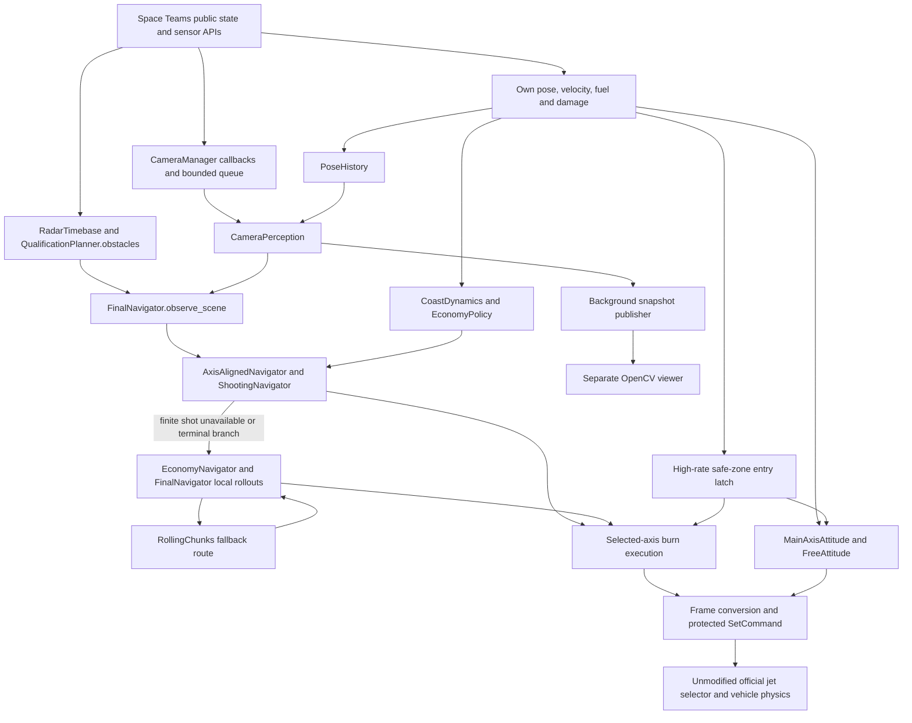

# Final Submission Algorithm

*SCORE_MOMENTUM: sensor-fused, score-aware finite-burn guidance for Escape from Phobos*

**Team SUST IGNITION — Shahjalal University of Science and Technology, Bangladesh**<br>
**Team members:** Md. Abdullah Al Sami Chowdhury; Zarif Hasan Sadiq; Arjun Shill<br>
**Team advisor:** Irfan Nafiz Shahan, Lecturer, Department of Electrical & Electronics Engineering, SUST<br>
**Document date:** 21 November 2026

## Abstract

This paper documents the delivered Python controller for the Escape from Phobos
simulation. The controller combines timestamped radar tracking, asynchronous RGB
and depth perception, finite-duration body-axis burn scheduling, short-horizon
collision assessment, and momentum-preserving feedback. Candidate maneuvers are
ranked using the competition's time, fuel, and damage score. A guarded radial
launch and one-time alignment of the stronger translation axis precede cruise;
local trajectory rollouts provide fallback avoidance, and terminal guidance aims
to cross the rescue spacecraft's scoring sphere without requiring a stop. The
implementation remains in `Controller.py`; camera visualization is an optional,
separate process. The two runs in the user-identified uploaded final submission
scored 48.4 and 47.1, with mean 47.75, mean entry time 217.90 s, mean entry fuel
43.01 kg, and zero scored damage. Both startup logs identify the exact controller
hash documented here. This submitted pair exceeds the requested 45-point average;
the desired 55-point average was not demonstrated. An earlier, separate
three-run development cohort averaged 41.27 and is retained for comparison.
Offline experiments support a modest radar-estimation
improvement but do not establish equivalent native gains. This document explains
the implemented method, its approximations, and the limits of the available
evidence rather than presenting an unverified optimality or safety claim.

**Keywords:** spacecraft guidance; finite burns; radar tracking; depth perception;
receding-horizon planning; fuel-aware control; collision avoidance.

## Document identity and evidence conventions

The implementation described here is the repository-root
[`Controller.py`](Controller.py), with byte-level SHA-256:

```text
4210afa43e5a2570eb3fcd12c6e276c8697a69da631931fb1abeac3613332834
```

The repository HEAD inspected before this documentation reorganization was
`3a578f13e5a8188589fbfa68edaadaf275afdd1b`. The controller hash, rather than a
profile name alone, identifies the selected algorithm. `SCORE_MOMENTUM` has named
several different historical revisions. The document is an implementation report,
not a peer-reviewed publication or a claim of competition-winning performance.

Three evidence labels are used throughout:

| Label | Meaning |
| --- | --- |
| **Implemented / source-verified** | Directly observable in the selected source or inspected official simulator sources. |
| **Measured** | Recorded native results, software timings, or saved test outcomes; the measurement environment is identified. |
| **Modeled / assumed** | Forecasts, simplified physics, synthetic sensors, risk estimates, and counterfactuals; these are not official flight results. |

Current setup instructions remain in [README.md](README.md). Superseded designs
are indexed in [previous works](previous%20works/README.md); they do not define
the delivered configuration. The development experiment audit is
[`tests/nov20_experiment_report.md`](tests/nov20_experiment_report.md). The
subsequently supplied final-submission logs are summarized, with source hashes
and verbatim result evidence, in
[`docs/finalsubmission2_results.json`](docs/finalsubmission2_results.json).
The user identifies this archive as the uploaded competition submission; the
logs establish native run outcomes, not organizer acceptance or ranking [18].

## Contents

1. [Mission definition and scoring](#1-mission-definition-and-scoring)
2. [Notation, frames, and interfaces](#2-notation-frames-and-interfaces)
3. [System architecture](#3-system-architecture)
4. [Dynamics, actuation, and fuel modeling](#4-dynamics-actuation-and-fuel-modeling)
5. [Radar perception and tracking](#5-radar-perception-and-tracking)
6. [RGB/depth perception and sensor fusion](#6-rgbdepth-perception-and-sensor-fusion)
7. [Finite-burn trajectory generation](#7-finite-burn-trajectory-generation)
8. [Collision assessment and candidate selection](#8-collision-assessment-and-candidate-selection)
9. [Burn execution and momentum preservation](#9-burn-execution-and-momentum-preservation)
10. [Fallback routing and local avoidance](#10-fallback-routing-and-local-avoidance)
11. [Launch, attitude, and terminal behavior](#11-launch-attitude-and-terminal-behavior)
12. [Runtime scheduling and fault handling](#12-runtime-scheduling-and-fault-handling)
13. [Runtime configuration](#13-runtime-configuration)
14. [Validation methodology and results](#14-validation-methodology-and-results)
15. [Limitations and interpretation](#15-limitations-and-interpretation)
16. [Reproduction and deployment](#16-reproduction-and-deployment)
17. [Conclusions](#17-conclusions)
18. [References](#18-references)

[Appendix A: source-section guide](#appendix-a-source-section-reading-guide) ·
[Appendix B: tests](#appendix-b-what-the-tests-do)

## 1. Mission definition and scoring

### 1.1 Task and success condition

The final scenario places the crew vehicle approximately 1,306 m from the rescue
spacecraft among approximately 500 moving debris objects. The mission objective
is entry into a sphere of radius 50 m around the designated spacecraft reference
frame. Docking, zero relative velocity, and physical contact with the station are
not prerequisites for success.

The inspected official `Scoring.py` first checks whether damage exceeds its
threshold, then checks a distance **less than or equal to** `KeepOutRadius_m`.
For this installed scenario, the radius is 50 m and the damage threshold is
209,200 J. The winning result is latched. Later motion or station contact does
not revise that already recorded result. Damage before entry can still lower
the score or end the attempt. Fuel has a score cost but no mission-ending cap.
These details describe the inspected scorer; its official output remains the
authority [3, 4].

### 1.2 Arrival score

For elapsed entry time $T>0$, entry fuel $F$, and scored damage $D$:

$$
S(T,F,D)=100\left(0.5+\frac{120}{T}-\frac{F}{75}
-\frac{2D}{209200}\right).
$$

The score is not clipped to 0–100. Negative values are actual negative scores.
The controller's `mission_score()` implements this arrival expression. Official
failure scoring substitutes a negative normalized remaining-distance term for
the positive time term; this controller seeks successful entry rather than
optimizing that failure expression.

The local score sensitivities are:

$$
\frac{\partial S}{\partial T}=-\frac{12000}{T^2},\qquad
\frac{\partial S}{\partial F}=-\frac{100}{75},\qquad
\frac{\partial S}{\partial D}=-\frac{200}{209200}.
$$

Consequently, 1 kg costs approximately 1.333 points, and 1,000 J costs
approximately 0.956 points. At 200 s, saving one second is worth approximately
0.30 points: an extra kilogram must save about 4.44 s to pay for itself locally,
assuming unchanged damage. Damage also causes unmodeled recovery time and
impulse, so its explicit score coefficient alone does not determine whether a
collision is economical.

For two prospective trajectories, the exact arrival-score difference is:

$$
\Delta S=12000\left(\frac{1}{T_{new}}-\frac{1}{T_{old}}\right)
-\frac{100}{75}\Delta F-\frac{200}{209200}\Delta D.
$$

**Modeled examples; these are not flight measurements:**

| Time | Fuel | Damage | Calculated score |
| ---: | ---: | ---: | ---: |
| 180 s | 40 kg | 0 J | 63.33 |
| 200 s | 40 kg | 0 J | 56.67 |
| 200 s | 50 kg | 0 J | 43.33 |
| 220 s | 45 kg | 0 J | 44.55 |
| 230 s | 40 kg | 0 J | 48.84 |

For a desired score $S_*$ at zero damage, the allowable fuel is
$F\leq75(0.5+120/T-S_*/100)$. Thus low fuel alone does not imply a high score:
delaying arrival can erase the saving. The delivered controller has no rule
that arbitrarily stops thrust at 40 or 50 kg.

## 2. Notation, frames, and interfaces

### 2.1 State and coordinate convention

| Symbol | Meaning | Units / frame |
| --- | --- | --- |
| $P$ | Phobos body-fixed planning frame | Rotating local celestial-body frame |
| $B$ | Vehicle body frame | Body +X is the nose direction |
| $\mathbf r,\mathbf v$ | Own vehicle position and velocity | m, m/s; expressed in $P$ |
| $\mathbf r_s,\mathbf v_s$ | Rescue spacecraft state | m, m/s; expressed in $P$ |
| $R$ | Direction cosine matrix mapping $P$ vectors to $B$ | $\mathbf a_B=R\mathbf a_P$ |
| $\mathbf g$ | Local acceleration estimate used in prediction | m/s², $P$ |
| $\Delta\mathbf v_B$ | Scheduled body-axis thrust increments | m/s, $B$ |
| $s_i,\tau_i,a_i$ | Axis-burn start, duration, acceleration magnitude | s, s, m/s² |
| $\rho$ | Nominal tangent-pass miss distance | 47 m |
| $q_j$ | Track uncertainty-growth parameter | m/s; heuristic |

Although some source variables use `world` in their names, the navigation frame
is $P$, not an inertial frame. The source uses NumPy row arrays in several batch
operations; for example `dv @ rotation` is the row-vector equivalent of
$R^T\Delta\mathbf v_B$ for column vectors.

Radial up at launch is $\mathbf u=\mathbf r_0/\|\mathbf r_0\|$. It is not a
camera-estimated terrain normal, and it is not a hard-coded global +Z direction.
The relative state and measured DCM determine every commanded direction.

### 2.2 Simulator interface contract

The protected prefix of `Controller.py` establishes the connection and obtains
handles to Phobos, the vehicle, the destination, and two cameras. Its
`GetNearestDebrisLocations()`, `PanTiltCamera()`, and `SetCommand()` helpers remain
unchanged. The finalization audit verified the 2,829-byte protected prefix against
the baseline [5].

`SetCommand()` writes a **body-frame acceleration request** and a **body-frame
angular-acceleration request** to the official jet selector. The controller does
not command individual thrusters. It converts a planned $P$-frame translation
request through the simulator frame API before issuing the command.

The destination state is obtained through its public entity API. RGB images are
not used to invent or independently triangulate the station's global position.
Vision supplies occupied surfaces and view coverage; radar supplies debris
measurements. Hidden debris states and benchmark ground truth are not inputs to
the live controller.

## 3. System architecture

### 3.1 Composition and inheritance

The default planner is `AxisAlignedNavigator`, with this inheritance chain:

```text
QualificationPlanner
  └─ FinalNavigator
       └─ EconomyNavigator
            └─ ShootingNavigator
                 └─ AxisAlignedNavigator       [default runtime object]
```

Inheritance supplies tracking, scene construction, local avoidance, economy
control, finite-burn planning, and finally the one-time strong-axis alignment.
An inherited method can execute on the same planner object; these are not five
independent controllers running concurrently.



**Figure 1.** Implemented data and command flow. The viewer has no command path
back to the vehicle. Camera callbacks are asynchronous; trajectory planning is
synchronous in the selected control loop.

### 3.2 Repository responsibilities

| File / group | Responsibility | Needed by the live controller? |
| --- | --- | --- |
| `Controller.py` | Connection, sensor interpretation, guidance, translation/attitude requests, entry detection, logging | Yes |
| `camera_viewer.py` | Snapshot transport helper and separate RGB/depth GUI | For the default preview; flight can continue without the viewer |
| `BasicController.py` | Official-style starter/example controller | No; not imported by the delivered controller |
| `UserAPI.py` | API usage reference | No; not imported by the delivered controller |
| `requirements.txt` | Tested Python package versions; SDK is supplied separately by Space Teams PRO | Installation metadata |
| `tests/` | Unit tests, API doubles, offline harnesses, source snapshots, and saved evidence | No live navigation dependency |
| `context.md` | Development decisions and selected-version history | Documentation only |
| `previous works/` | Superseded algorithm descriptions and the preceding tuning report | Documentation only |

Keeping the executable navigation in one file preserves the competition's
`Local/Repos/STU4-Solution/Controller.py` launch contract. It does not imply a
single unstructured algorithm: named classes separate perception, prediction,
planning, execution, and observation.

## 4. Dynamics, actuation, and fuel modeling

### 4.1 Local motion approximation

The online model uses:

$$
\dot{\mathbf r}=\mathbf v,\qquad
\dot{\mathbf v}=\mathbf a_{thrust}+\hat{\mathbf g}(\mathbf r),\qquad
\hat{\mathbf g}(\mathbf r)=
-\mu_c\frac{\mathbf r}{\|\mathbf r\|^3}+\hat{\mathbf b}.
$$

The selected code sets $\mu_c=711000\ \mathrm{m^3/s^2}$ and holds the evaluated
acceleration constant within a candidate rollout. $\hat{\mathbf b}$ is an
empirically learned residual. These are prediction choices, not modifications
to simulator physics.

The inspected scenario has active Mars and Phobos gravitational field effects;
its Phobos parameter is $707500\ \mathrm{m^3/s^2}$. The selected controller does
not explicitly reconstruct the complete celestial/frame dynamics. Its residual
can absorb local discrepancies but does not establish a globally valid force
model. In particular, a zero-thrust coast is generally neither constant-speed
nor a perfectly straight line in $P$.

### 4.2 Unpowered drift estimation

`CoastDynamics` learns only after launch and during unpowered intervals. It fits
velocity versus time over up to 3 s of samples, requires at least 1.5 s of span,
and updates no faster than every 0.5 s. With centered sample times $t_k$:

$$
\hat{\mathbf a}_{obs}=
\frac{\sum_k(t_k-\bar t)\mathbf v_k}
{\sum_k(t_k-\bar t)^2},\qquad
\mathbf b_{obs}=\hat{\mathbf a}_{obs}
-\frac{1}{n}\sum_k\mathbf g_{nominal}(\mathbf r_k).
$$

Accepted residuals have norm below 0.02 m/s². The observation is clipped to
0.01 m/s² and filtered as
$\hat{\mathbf b}\leftarrow0.8\hat{\mathbf b}+0.2\mathbf b_{clipped}$.
Powered samples clear the fit window. An observed damage increase introduces a
3 s quiet period to avoid treating collision impulses as gravity. The selected
controller does not contain the later powered-drift learning prototype.

### 4.3 Physical axis capability versus command magnitude

The finite-burn planner starts from the following reference allocator model:

| Body axis | Positive-direction acceleration | Negative-direction acceleration |
| --- | ---: | ---: |
| X | 0.1745625 m/s² | 0.096562 m/s² |
| Y | 0.1431816 m/s² | 0.096444 m/s² |
| Z | 0.095813 m/s² | 0.11655 m/s² |

These are modeled capabilities at the reference mass and zero requested angular
acceleration, not independently measured thrust guarantees for every native tick.
During a sufficiently long, approximately single-axis burn, the controller
updates an axis estimate from gravity-corrected velocity change using a 0.85/0.15
filter. It rejects intervals with substantial transverse acceleration.

The translation request limit of 0.5 m/s² is therefore not an achieved 0.5 m/s²
vehicle acceleration. Likewise, the main loop's angular-request cap of
0.02 rad/s² is a request bound. Actual forces and torques are selected by the
unchanged allocator.

### 4.4 Why small requests can still consume fuel

The official selector solves a nonnegative linear program of the form
$\min\mathbf1^T\mathbf u$ subject to $A\mathbf u=\mathbf b$, using its
published jet geometry and acceleration/torque command vector. Its effective
on-time mapping is implemented as

$$
t_i^{eff}=\frac{\max(u_i,0)}{u_{max}}\min(\Delta t,u_{max}),
\qquad u_{max}=\max_i\max(u_i,0),
$$

for nonzero $u_{max}$. Consequently the request magnitude is not a simple
physical acceleration calibration. Repeated low-amplitude commands can still
generate appreciable pulses. The controller uses deadbands, completed-axis
latches, and coast states rather than continuously canceling every small error.

### 4.5 Fuel as accumulated impulse

Using the reference mass $m_0=3388.7$ kg, $I_{sp}=80$ s, and $g_0=9.8$ m/s²:

$$
k_F=\frac{m_0}{I_{sp}g_0}
=\frac{3388.7}{80\times9.8}
\simeq4.32232\ \frac{\mathrm{kg}}{\mathrm{m/s}}.
$$

For sequential body-axis burns, the planner estimates
$F_{future}=k_F\sum_i|\Delta v_{B,i}|$. This is an L1 impulse estimate, not
$k_F\|\Delta\mathbf v\|_2$ for arbitrary multi-axis maneuvering, and not a
complete accounting of attitude or recovery fuel. At the reference coefficient,
one additional m/s of thrust impulse costs approximately 5.76 score points.

All axes use the same specific-impulse fuel model. Different axis capacities,
gravity opposition, torque balancing, and repeated corrections produce different
time and fuel outcomes; there is no separate inherently cheaper "horizontal
fuel." A vehicle already moving quickly can coast without translational fuel,
while a low-speed vehicle that repeatedly changes direction can consume much more.

## 5. Radar perception and tracking

### 5.1 Measurement structure and update cadence

The controller requests the entire available radar list using
`GetNearestDebrisLocations(10000)`. Each accepted report is a finite $3\times3$
matrix:

$$
Z_j=\begin{bmatrix}
r_x&r_y&r_z\\
d_{surface}&\dot d_{LOS}&d_{diameter}\\
t_{report}&0&0
\end{bmatrix}.
$$

The first row is vehicle-relative position expressed in $P$; the Doppler term
is relative line-of-sight speed, not a full 3-D velocity vector. The selected
tracker uses position, Doppler, diameter, and timestamp. It does not fuse the
independent closest-surface measurement into the center estimate; that later
prototype was not selected.

The inspected configuration specifies 2 m position standard deviation,
0.02 m/s radial-speed standard deviation, and 5% diameter standard deviation.
The radar process updates one object per iteration at a requested 120 Hz and
publishes sorted batches. With 500 objects, a nominal sweep takes about 4.17 s;
API and scheduling delays can lengthen it. Reading at 2 Hz does not make all
reports simultaneous or newly measured. Sorted indices cannot be track IDs.

### 5.2 Timebase alignment

Radar timestamps and controller elapsed time use different startup epochs.
`RadarTimebase` estimates their offset from the lower envelope of
`controller_now - newest_report_timestamp`. It locks after at least 6 s and five
distinct publications. A 0.25 s deadband, 0.05 s transport allowance, and ±5 s
clamp reduce sensitivity to batching. The estimate is fixed after locking.

This is a latency-aware estimate, not an exact clock synchronization protocol.
When a nonzero offset locks, the report cache is cleared to rebuild time-consistent
tracks. A zero-offset lock preserves the cache. The three selected native runs
estimated offsets of approximately 0.271, 0.420, and 0.708 s; those numbers must
not be interpreted as independently measured clock truth.

### 5.3 Own-motion correction and association

The tracker retains 60 s of own position/velocity history. At report time $t_j$:

$$
\hat{\mathbf p}_j(t_j)=\mathbf r_{measured,j}+\mathbf r_{vehicle}(t_j),\qquad
\hat v_{radial,j}=\dot d_{LOS,j}
+\mathbf v_{vehicle}(t_j)^T\hat{\mathbf n}_j.
$$

It interpolates own state to the report timestamp rather than adding the current
vehicle position to an old measurement. Exact repeated report matrices retain
their cached track identity. New reports are associated with gravity-propagated
old tracks using time, diameter, and position-residual gates:

- report separation between 0.4 and 8 s;
- diameter difference no greater than the larger of 3 m and 25% of the previous diameter;
- position residual below $8+2\Delta t$ metres;
- an ambiguity check requiring the second-best residual to exceed the best by more than 4 m when multiple matches exist.

Ambiguous reports start with a radial-only estimate instead of silently assigning
an uncertain transverse velocity. These gates are engineering heuristics; they
do not guarantee correct identity association in every dense encounter.

### 5.4 Multi-report velocity and position estimates

A track keeps up to eight position observations within 30 s. After compensating
the samples for the nominal acceleration, a centered linear regression estimates
the velocity slope:

$$
\hat{\mathbf v}_{fit}=
\frac{\sum_k(t_k-\bar t)\tilde{\mathbf p}_k}
{\sum_k(t_k-\bar t)^2}.
$$

The slope is blended with the prior propagated velocity, with gain 0.3 for short
histories and 0.75 after a span of at least 6 s. The fitted speed is bounded before
blending. The Doppler constraint then replaces its radial component:

$$
\hat{\mathbf v}=\mathbf v_{filtered}
+(\hat v_{radial}-\mathbf v_{filtered}^T\hat{\mathbf n})\hat{\mathbf n}.
$$

With at least four observations spanning at least 8 s, regression residuals
determine a forecast-growth rate clipped to 0.25–0.6 m/s. Confidence requires
residual RMS below 5 m and rate below 0.55 m/s. For confident tracks, the selected
position-smoothing feature projects the fitted line to the **latest report time**:

$$
\hat{\mathbf p}_{fit}(t_{last})=
\bar{\tilde{\mathbf p}}+(t_{last}-\bar t)\hat{\mathbf v}_{fit}.
$$

This replaces a noisy latest position without simply averaging away the motion.
It does not tighten the existing safety margins. Cache replay reuses that fitted
position without repeatedly adding the correction.

### 5.5 Age propagation and occupied bounds

For report age $A_j$ and nominal debris acceleration $\mathbf a_j$:

$$
\hat{\mathbf c}_j(now)=\hat{\mathbf p}_j(t_j)-\mathbf r(now)
+A_j\hat{\mathbf v}_j+\tfrac12 A_j^2\mathbf a_j.
$$

The selected architecture maintains distinct quantities:

| Quantity | Selected radar expression / purpose |
| --- | --- |
| Scene radius used by economy/fallback paths | $\max(0.575d_j+7+q_jA_j+h_j,3)$ m, where $h_j$ covers missing own-history uncertainty |
| Risk core radius | $0.575d_j+5$ m |
| Finite-shot hard radius | $\max(r_{core,j}-1,3)$ m |
| Forecast variance | Position variance plus age/time-scaled velocity uncertainty; defined in Section 8 |

These are conservative modeled occupied bounds, not measured physical radii.
The rejected `EFP_PHYSICAL_RISK` experiment used a different core/covariance
construction. It is disabled in the delivered configuration.

## 6. RGB/depth perception and sensor fusion

### 6.1 Capture and pose association

There are two physical cameras, top and bottom, each producing RGB and depth
captures. The implementation requests 96×64 images with an 80° vertical field of
view. At most four requests per second are scheduled across the cameras, alternating
top/bottom; each camera follows a depth, depth, RGB sequence. Actual delivery may
be slower.

`CameraManager` allows one outstanding request per camera, uses unique capture
IDs, and places callbacks into a queue of at most eight images. Requests time
out after 3 s; three accumulated failures disable further requests for that
camera in the manager instance. A simulation reset changes the callback generation
so old-generation images cannot enter the new mission's perception state.

`PoseHistory` keeps up to 900 own poses. A capture needs a nearby pose within
0.15 s; position is interpolated and the nearest recorded orientation is used.
Images older than 2 s, badly shaped images, or images without an associated pose
are rejected for navigation. This is pose association, not a guarantee of perfect
camera exposure/gimbal synchronization.

### 6.2 Depth projection and occupied surfaces

Depth is camera-forward X in centimetres. With focal parameter
$f=H/(2\tan(FOV/2))$, pixel $(u,v)$ and depth $d_X$ metres produce:

$$
\mathbf p_C=d_X
\begin{bmatrix}
1\\(u+0.5-W/2)/f\\-(v+0.5-H/2)/f
\end{bmatrix},\qquad
\mathbf p_P=\mathbf o_C+R^TR_{CP}^T\mathbf p_C.
$$

Here $R_{CP}$ denotes the body-to-camera gimbal rotation used by
`camera_rotation()`. The camera origin includes its body-frame mounting offset:
top $[1.27,0,0.9]$ m or bottom $[1.675,0,-1.025]$ m, transformed through the own
vehicle pose. The exact matrix construction in the source is the authority for
sign and rotation order.

Valid depth is finite and between 4 and 400 m. Four-connected regions use a
depth-relative discontinuity criterion. Large surfaces are tiled before bounding:
near surfaces use 12-pixel cells and distant surfaces above 40 m median depth use
2-pixel cells. This avoids enclosing an entire terrain plane in one misleadingly
large sphere. Each tile's bounding radius includes its geometric extent, two
3 m allowances, and 2% of range. Up to 384 nearest volumes per camera are retained.

### 6.3 RGB bearings and radar association

RGB processing thresholds brightness relative to black space and extracts
connected contrast regions. Region centers become world-frame bearings and
angular spreads. They are **generic visual regions**, not a trained neural
detector or a semantic meteoroid/spacecraft classifier.

RGB has no independent metric range. Its bearings are matched to radar tracks;
the nearest compatible association supplies position and velocity. Depth volumes
can borrow a nearby radar track's velocity. Volumes already enclosed by radar
occupancy are not added again, and the risk planner removes exact RGB copies of
existing radar bounds. Unmatched depth surfaces remain conservatively occupied.

### 6.4 Sensor roles during cruise and capture

With radar present, launch complete, distance above 300 m, and positive outward
radial motion, `observe_scene()` omits camera occupancy from cruise navigation.
This avoids duplicate distant depth bounds while radar still tracks all reports.
Capture requests, image processing, and the optional viewer can continue.
Vision remains relevant to launch terrain and station approach.

`CameraPerception.observes()` means a fresh depth view covered the station bearing
within the image and configured range, with an angular edge margin. It is not
semantic station recognition or proof of an unobstructed docking corridor.

### 6.5 Camera interface

`camera_viewer.py` contains `PreviewPublisher`, which writes latest-only NumPy
snapshots on a background thread, capped at 5 Hz in the inspected helper. A
separate OpenCV process displays the four streams, generic detection boxes,
capture ages, and controller telemetry, with a roughly 10 Hz event loop. The
controller does not wait for window events or disk compression. Camera decoding
and perception in `drain()` still execute in the control process.

Closing or failing the viewer does not stop autonomous flight. The interface is
optional; its operational guide remains [CAMERA_GUI.md](CAMERA_GUI.md). It shows
sensor evidence and controller estimates, not an official score certification.

## 7. Finite-burn trajectory generation

### 7.1 Planning problem and operating region

`ShootingNavigator` is the principal cruise optimizer. At a planning update it
seeks a maneuver with a high predicted arrival score, feasible directional
acceleration, and acceptable near-term sensor-derived clearance. Its control
variables are a terminal pass direction, remaining flight time, order of body-axis
burns, and optional lateral impulse. It searches a finite candidate set; it does
not solve a globally optimal continuous-control problem.

The shooting layer delegates to its inherited navigator while launch is
unfinished, below 280 m target distance, after failure or arrival, or when the
optional nose-first mode is enabled. Terminal geometry must also provide a valid
cruise goal. Failure to find a feasible shooting candidate invokes local guidance
rather than ending the mission.

### 7.2 Tangent-pass goals

Let $d=\|\mathbf r-\mathbf r_s\|$, and let
$\mathbf o=(\mathbf r-\mathbf r_s)/d$ point from the station toward the vehicle.
Two orthonormal vectors $\mathbf e_1,\mathbf e_2$ span the plane perpendicular to
$\mathbf o$. Sixteen pass directions are formed with
$\theta_k=k\pi/8$, $k=0,\ldots,15$:

$$
\mathbf q_k=\cos\theta_k\,\mathbf e_1+\sin\theta_k\,\mathbf e_2,
\qquad
\mathbf h_k=-\sqrt{1-(\rho/d)^2}\,\mathbf o+(\rho/d)\mathbf q_k,
$$

$$
\mathbf r_{g,k}=\mathbf r+d\sqrt{1-(\rho/d)^2}\,\mathbf h_k,
\qquad \rho=47\text{ m}.
$$

For a stationary target and a straight line along $\mathbf h_k$, this construction
places the closest point 47 m from the station reference. It provides a 3 m radial
margin inside the 50 m scoring sphere while allowing a pass beside the hull.
Station velocity is included subsequently in the finite-burn endpoint equation.
The 47 m value is a design choice, not a measured hull radius.

When camera coverage near the station is available, slowly moving observed
volumes within 85 m of it are treated as potential hull geometry. A pass is
screened along the segment to its goal and a 100 m extension; required clearance
is greater than 1 m. This is conservative screening beyond the scoring point,
not docking or semantic recognition of the spacecraft.

### 7.3 Sequential body-axis solution

The default time grid is 45, 55, ..., 445 s from the current update. The previous
absolute ETA can add one extra time. Six permutations of the three body axes are
tested for each of 16 goals, giving 3,936 base combinations before that addition.
The default has no deliberate coast-before-ignition prefix.

For remaining time $t_f$, the displacement that thrust must supply is

$$
\mathbf d_B=R\left[\mathbf r_g-\mathbf r
 +(\mathbf v_s-\mathbf v)t_f-\tfrac12\mathbf g t_f^2\right].
$$

Consider axis $i$, with signed velocity increment $\Delta v_i$, positive burn
magnitude $a_i$ selected for that direction, start time $s_i$, and duration
$\tau_i=|\Delta v_i|/a_i$. Its endpoint contribution is

$$
d_i=\Delta v_i\left(t_f-s_i-\tfrac12\tau_i\right).
$$

Writing $L_i=t_f-s_i$, the smaller physically useful root is

$$
\tau_i=L_i-\sqrt{L_i^2-2|d_i|/a_i},\qquad
\Delta v_i=\operatorname{sign}(d_i)a_i\tau_i.
$$

`axis_schedule()` solves this in the selected axis order, advancing $s_i$ by the
previous burns' durations. Negative discriminants and exhausted available time
invalidate a candidate. The model assumes a fixed attitude during this schedule;
measured attitude is used again at the next planning update.

For evaluating intermediate positions, define
$u_i(t)=\operatorname{clip}(t-s_i,0,\tau_i)$ and
$c_i(t)=\max(t-s_i-\tau_i,0)$. Then

$$
b_i(t)=\tfrac12\frac{\Delta v_i}{\tau_i}u_i(t)^2
       +\Delta v_i c_i(t),
$$

$$
\Delta\mathbf r(t)=\mathbf v t+\tfrac12\mathbf g t^2+R^T\mathbf b(t).
$$

Zero-duration components contribute zero. `scheduled_positions()` evaluates
these trajectories in batches for collision assessment.

### 7.4 Score and feasibility filters

Initial fuel prediction is $F_{future}=k_F\sum_i|\Delta v_i|$, with the coefficient
derived in Section 4. The initial candidate score is
$S(t_{now}+t_f,F_{used}+F_{future},D_{used})$. This prices useful acceleration
against total arrival time, rather than enforcing a prescribed speed or fuel cap.

The post-burn speed proxy is
$\|\mathbf v+R^T\Delta\mathbf v_B+\mathbf g\sum_i\tau_i-\mathbf v_s\|$.
It must not exceed the larger of the requested cruise ceiling and current
relative speed, plus 0.05 m/s. This is a post-burn proxy, not a bound on every
instant of a gravity-affected flight. Net thrust projected toward the station
must be at least −0.04 m/s: a change in score preference should not itself
cancel substantial useful forward momentum. Emergency fallback can still brake.

The optimizer retains the best few scores, at least the best valid shot per pass
direction, representatives of several arrival-time bands, and an eligible
previous schedule. This keeps alternatives without running the expensive risk
calculation on all base combinations.

### 7.5 Lateral impulse variants and their limitation

The two leading base shots also generate transverse impulse offsets of
0.15, 0.35, 0.7, and 1.0 m/s in eight azimuths. This feature is already present
when `EFP_DETOUR_DIVERSITY=0`; that flag controls additional diversity, not the
existence of all detours.

The rollout adds the offset to the initial burn and predicts a compensating
increment of $-2\,\Delta\mathbf v_{offset}$ later, no earlier than completion of
the first schedule and approximately halfway through the candidate time. Both
increments are included in modeled fuel. With ideal instantaneous increments,
this produces a two-leg lateral excursion that returns toward the endpoint.
Finite burn durations make it approximate.

**Implemented limitation:** this selected revision has no separate committed
return-burn executor. It executes the current velocity target, limits retention
near the predicted counter-burn time, and replans from updated measurements.
The compensating burn is a forecast used for scoring and clearance, not a
guaranteed future command. This method must not be described as the later
archived `DoglegNavigator`, a smooth curve around an inferred debris box, or a
globally certified route around the entire field.

### 7.6 Explicit coast candidate and time approximation

`ballistic_pass()` predicts a closest future pass under locally constant
acceleration. In the default shooting layer, a zero-thrust candidate is added
when predicted miss is strictly between 42 and 48 m and closest-pass time is
between 5 and 600 s. The broader acceptance experiment is disabled.

The default shooting score often uses time to the 47 m closest-pass goal, while
the official clock stops at the earlier 50 m entry. For an ideal 47 m straight
pass, the entry-to-closest-point distance is
$\sqrt{50^2-47^2}=17.06$ m: about 2.44 s at 7 m/s. This is a known time-model
approximation. The fallback economy policy uses a capture-line remaining
distance that explicitly subtracts this entry offset.

## 8. Collision assessment and candidate selection

### 8.1 Receding sensor horizon

The hard shooting horizon is
$H=\min(20\text{ s},0.45\min t_f)$. There are 21 position samples and 20
piecewise-linear relative-motion segments. A reachability filter excludes
objects beyond the candidates' maximum horizon displacement plus their possible
motion, radius, and a 15 m allowance. All tracked reports remain available;
screening distant unreachable objects reduces the current batch cost.

For debris $j$, the predicted center is

$$
\mathbf c_j(t)=\mathbf c_j(0)+\mathbf v_jt+\tfrac12\mathbf a_jt^2,
$$

using the existing local gravity estimate and tracked motion. For a candidate
vehicle trajectory, let $\mathbf a$ and $\mathbf b$ be debris-minus-vehicle
separation at adjacent sample times. The minimum separation on their relative
line segment is computed analytically:

$$
\lambda=\operatorname{clip}
 \left(\frac{-\mathbf a\cdot(\mathbf b-\mathbf a)}
 {\|\mathbf b-\mathbf a\|^2},0,1\right),\qquad
d_{min}=\|\mathbf a+\lambda(\mathbf b-\mathbf a)\|.
$$

The implementation guards the denominator near zero. This catches between-sample
crossings that checking endpoints alone would miss. It still approximates curved
relative motion; a margin $0.03+0.25\Delta t^2/8$ m is included.

### 8.2 Geometric and uncertain occupancy

The default radar risk core radius is $0.575D_j+5$ m for measured diameter $D_j$.
The hard geometric radius is $\max(r_{core}-1,3)$ m. Camera-only volumes retain
their conservative perception bounds, with additional future uncertainty growth
up to 10 m. These are controller allowances, not exact physical object meshes.

The radar separation uncertainty used by the risk surrogate is

$$
\sigma_j(t)=\sqrt{4+
 \left[\frac{(age_j+t)q_j}{c_j}\right]^2},\qquad
c_j=\begin{cases}2.2&\text{confident track},\\1.2&\text{otherwise}.\end{cases}
$$

The initial 4 m² term corresponds to a 2 m standard deviation. The selected
configuration does not replace the inflated core with the smaller experimental
physical-radius model. A reduced-radius experiment appeared favorable offline
but produced a native collision and was rejected.

A segment already inside an inflated volume may be geometrically exempted if it
moves monotonically away from that volume. This permits departure from initial
conservative overlaps. It does not erase every probabilistic penalty and does
not permit a new inward crossing.

### 8.3 Expected impact and recovery surrogates

For signed risk-core gap $g$, the active expected-risk calculation uses

$$
p=\tfrac12\operatorname{erfc}
 \left(\frac{\max(g,0)}{\sqrt2\max(\sigma,0.1)}\right),\qquad
E=3388.7\,v_{rel}^2.
$$

This $p$ is a one-dimensional uncertainty-tail surrogate. It is capped at 0.5
even for negative gap and is not a calibrated three-dimensional collision
probability. The energy expression is a conservative proxy; it is not the
official collision-damage law. The optional factor of one half is disabled.

For each debris object, the maximum $pE$ across segments is retained; the sum
over objects is called expected damage. Similarly, the maximum per-object
recovery surrogate $p(5+v_{rel}/0.1)$ is accumulated into $R_{delay}$. It models
five seconds of disruption plus replacement of lost speed at 0.1 m/s². Its
assumptions have not been fitted as a native collision-recovery distribution.

Hard candidate eligibility requires all of the following:

- Minimum inflated clearance greater than 0.5 m.
- Sum of per-object fatal-impact risk surrogates below 0.01, where the energy
  proxy exceeds remaining damage tolerance.
- Expected damage below 20% of remaining damage tolerance.

Eligible scores subtract $200D_{expected}/209200$ and add the time adjustment

$$
12000\left[\frac{1}{t_{now}+t_f+R_{delay}}
             -\frac{1}{t_{now}+t_f}\right].
$$

The optimizer therefore recognizes both direct damage cost and possible delay.
These estimates guide decisions; neither zero proxy risk nor a positive modeled
score certifies native clearance or performance.

### 8.4 Distant occupancy and plan retention

Six additional samples from $H+5$ s to the smaller of median candidate time and
200 s provide a distant geometry preference. Negative predicted gaps are
discounted by $\exp(-t/100)$; their score penalty is capped at 0.75 point.
This is deliberately a soft preference. Uncertain distant tracks do not certify
a complete safe lane from launch to station.

A candidate matching the previous ETA, goal, and axis order can be preferred
within 0.5 point of the best. A retained active burn can remain selected within
4 points during its first four seconds and within 2 points afterward. This
hysteresis reduces schedule changes but can retain thrust over a slightly
higher-scoring coast estimate. Removing that preference was tested separately;
it did not provide a statistically persuasive offline score gain and is not
part of the selected configuration.

### 8.5 Computational optimization

`vectorized_encounter_risk()` uses compiled `scipy.special.erfc` in place of
element-by-element Python evaluation of the same expression. Saved isolated
90-by-80-array measurements show median kernel time decreasing from 2.7299 ms
to 0.2128 ms, with maximum numerical difference $1.11\times10^{-16}$ [12].
The compiled-risk-only 20-seed cohort reproduced baseline flight metrics.
This is measured numerical equivalence and kernel acceleration, not evidence
of a twelvefold speedup of the complete controller or a native score increase.

## 9. Burn execution and momentum preservation

### 9.1 Velocity-increment feedback

The selected shot stores a world-frame target velocity
$\mathbf v_{burn}=\mathbf v_{start}+R^T\Delta\mathbf v_B$, its start time,
gravity estimate, axis order, and signs. Between planning updates,
`linear_command()` computes

$$
\mathbf e_B(t)=R(t)\left[\mathbf v_{burn}
 +\mathbf g_{start}(t-t_{start})-\mathbf v_{measured}(t)\right].
$$

It commands one body axis at a time in the stored order. An axis remains active
while its signed residual exceeds 0.02 m/s. Once complete, it is latched as done;
the executor does not alternate thrust signs to remove every residual. After
all axes finish, linear thrust is zero until another justified maneuver.

The 0.02 m/s threshold is a completion tolerance, not gradual throttle tapering.
The unpublished precision-impulse prototype is absent from this execution path.
For scale, an uncompensated 0.02 m/s transverse error accumulates 2–4 m over
100–200 s in a constant-velocity model. This explains why later sensor feedback
still matters even after a clean burn.

The command requests the allowed acceleration along that axis. The official
allocator chooses jets; actual acceleration is much smaller than the numerical
command ceiling in some directions. Burn duration is closed using observed
velocity, not an assumption that a 0.5 m/s² request produces 0.5 m/s².

### 9.2 Online actuation calibration

During sufficiently long, mostly single-axis burns, the planner subtracts local
gravity from measured velocity change and estimates delivered acceleration. It
accepts samples only for a bounded update interval, sufficient remaining burn,
plausible magnitude, and low transverse acceleration. The axis estimate is
updated as 85% previous value plus 15% new measurement.

This calibrates finite-burn timing against observed dynamics. It does not change
the jet table, thrust limits, fuel model, or official allocator. The fixed
shooting fuel coefficient is still an approximation when rotation, mixed-axis
commands, or repeated corrections add overhead.

### 9.3 Economy policy outside the shooting layer

`EconomyPolicy` ranks peak-speed choices from the current speed and a grid up to
10 m/s in 0.25 m/s increments, excluding choices below current speed. A simplified
accelerate-then-coast model estimates remaining time, gravity drag, impulse fuel,
and a 2 kg steering allowance. Acceleration is bounded to 0.06–0.17 m/s² and
opposing drag to 0–0.02 m/s² for this calculation. An empirical fuel-per-impulse
estimate is filtered and bounded to 4.32–14 kg/(m/s).

The policy compares full arrival scores using fuel already spent. It can decide
that a later boost is valuable when sufficient distance remains; it can also
decide to coast. There is no universal rule to accelerate at exactly 500 or
600 m, no guaranteed 8 m/s minimum, and no total-fuel lockout. The source's older
`MAX_SPEED=25` and `MIN_CRUISE=18` constants do not define this selected policy's
cruise behavior.

### 9.4 Hysteretic servo and course trims

When local guidance supplies a velocity target, `EconomyServo` uses hysteresis:
ordinary control begins above 0.32 m/s error and stops below 0.12 m/s; urgent
control uses 0.035 and 0.015 m/s. The proportional request is bounded by the
available command limit. Safe coasting suppresses ordinary velocity corrections.

`course_trim()` projects an intended correction across current travel, limits
its magnitude to 0.4 m/s, then restores the original relative-speed magnitude.
This changes the pass direction without deliberately cancelling useful forward
speed. It still costs fuel: preserving speed magnitude does not preserve the
velocity vector.

For an ideal impulsive turn through angle $\theta$ at speed $v$, the magnitude
of velocity change is $2v\sin(\theta/2)$. Continuous turning has integrated
acceleration $v\theta$. Both expressions describe idealized geometry; this
controller additionally pays body-axis allocation and attitude costs. Its
efficiency objective is therefore fewer necessary vector changes, not merely
a lower speed reading.

## 10. Fallback routing and local avoidance

### 10.1 Why two planning layers remain

Shooting can fail because feasible burns are blocked, terminal geometry is
unavailable, launch is incomplete, or the vehicle is near the station. The
inherited navigator then combines rolling route chunks and local velocity
rollouts. This fallback is necessary for mission completion, but repeated
avoidance can spend more fuel than an ideal launch-and-coast plan.

The selected implementation does not contain the later experimental dogleg
lane planner. `CorridorPlanner`, an older A* implementation retained in the
file, is also not the instantiated rolling-route engine on the default path.
The actual component used here is `RollingChunks`.

### 10.2 Direction selection and rolling chunks

`RollingChunks` first scores direct and tilted directions, using 15°, 30°, and
45° rings with eight azimuths, predicted congestion, and deviation from current
momentum. It samples a forward region extending up to 650 m; the economy mode
reduces the density weight so a distant uncertain obstacle does not automatically
justify an expensive large turn.

Chunk construction uses a bounded beam search over position/velocity states:
four stages, approximately thirteen velocity branches per state, eight rollout
steps per stage, and eight retained diverse states. The nominal acceleration
model is 0.11 m/s². The planning horizon is bounded and shortened near the
destination; candidate gaps must exceed 2 m with a capped time-dependent
inflation. This is a finite sampled search, not a proof of shortest path.

Existing waypoints are revalidated. A next chunk is prefetched before the
remaining route buffer becomes small, with an approximately two-second
prefetch cadence. The trigger considers a 350 m buffer and stopping distance
plus 250 m. Guidance looks tens of metres ahead, merging the next chunk while
following the current one. Reaching a chunk boundary does not itself require
stopping. If every candidate is blocked, however, fallback can slow or choose
a short local target; uninterrupted cruise is not guaranteed.

### 10.3 Local velocity rollouts

The local selector includes desired guidance, previous target, unpowered coast,
stop, and alternative directions. Above 3 m/s, fine avoidance adds small lateral
changes of 0.4, 0.65, and 1 m/s in eight azimuths, normalized to preserve the
candidate's speed. The rejected early-fine experiment would activate this
earlier; that change is not selected.

Cruise rollouts normally inspect 15 s, extending toward 30 s for approaching
encounters; non-cruise phases use a shorter horizon. Rollouts include estimated
acceleration and gravity, with the unpowered candidate explicitly using zero
thrust. Clearance, projected progress, required impulse, and an arrival-score
forecast influence the choice. Default local selection uses conservative
geometric uncertainty rather than enabling the separate experimental local
expected-risk scorer.

If no candidate passes its safety checks, the least-risk escape behavior takes
priority over nominal progress. Local braking or heading changes can therefore
occur before entry. Describing the controller as always coasting after an
arbitrary distance, or always flying outside the debris field, would not match
the implementation.

## 11. Launch, attitude, and terminal behavior

### 11.1 Guarded launch

`GuardedLaunch` records the initial radial up vector and origin. In the selected
shooting configuration its required radial height gain is 2.5 m; the older
top-level 3.5 m launch constant does not override this initialization. Launch
guidance uses a target above the origin and a 3 m/s speed setting, but the
handoff condition is the measured height gain, not arrival at that distant
guidance point or a commanded stop.

Launch candidates are checked against observed occupancy. Downward motion is
excluded, while monotonic departure from an already inflated initial overlap is
allowed. An axis-aligned pulse is used only when it points sufficiently close
to radial up. This short guarded departure reduces interference with the
surface without assuming that a long vertical climb is the best cruise route.

### 11.2 One-time strong-axis alignment

After launch, default `AxisAlignedNavigator` creates a fixed heading from the
current position toward the station. `MainAxisSlew` rotates body +X toward that
heading once, using the stronger positive-X translation capability. A four-second
scene forecast guards the maneuver; an unsafe approach returns control to normal
avoidance. An incomplete slew is abandoned after 25 s rather than blocking
navigation indefinitely.

While turning, translation can request up to 0.025 m/s² along the fixed heading;
this is a command magnitude, not guaranteed achieved acceleration. Within 2° of
alignment, translation is suppressed while angular rate settles. Completion
requires angular-rate norm below 0.0001 rad/s. Angular requests remain subject
to the main loop's limit.

After this maneuver, the attitude controller does not continuously force the
nose to follow every change in velocity or level the camera horizon. The
default `FreeAttitude` component damps spin with hysteresis: damping engages
above 0.01 rad/s and disengages below 0.002 rad/s. The optional nose-first
controller exists but is disabled. Thus the default is one initial useful
alignment followed by free attitude with spin damping, not continuous
aircraft-style pointing. A rotated pilot view alone is not a navigation error.

### 11.3 Terminal capture without a docking requirement

Below 280 m, the shooting layer hands control to the economy/local terminal
logic. `CaptureApproach` retains the 47 m tangent-pass construction and uses a
guidance goal extending roughly 500 m beyond the closest point. This encourages
crossing the sphere rather than stopping at a waypoint. Below approximately
260 m the mode can become `CAPTURE_PASS`.

Measured vehicle and target state determine whether the unpowered pass is
still suitable. Course trims can correct a predicted miss. Camera coverage and
near-station occupancy help screen the pass; no camera-derived station location
replaces the public target pose. The source's older terminal guard remains as a
fallback when no acceptable pass is found. It can use a standoff, survey, or
`BRAKE_SHIP` behavior before success. Consequently, the selected code eliminates
mandatory stopping as a capture objective, but does not remove every possible
pre-entry braking action.

### 11.4 High-rate entry latch and post-entry behavior

Entry observation runs between planning updates to catch a short crossing.
When planning-frame distance is below 65 m, the main loop also requests the
vehicle location directly relative to the rescue frame, matching the scorer's
distance reference. `observe_arrival()` accepts a finite distance at or below
50 m, latches the arrival time, cancels active shooting, and enters
`MISSION_COMPLETE_COAST`.

After this latch both translation and angular requests are zero. A pending
burn does not continue until the next half-second plan. The controller's
announcement directs the operator to the official Scoring log, which remains
the source of the congratulations, final score, and entry totals.

There is no commanded post-entry parking or docking maneuver in the active
path. Physical simulation can continue and produce a later station collision;
the official already-latched result is unchanged. The existence of a legacy
post-entry-braking method inside a fallback helper does not make it the default
arrival behavior: `EconomyNavigator` and the high-rate latch preempt that path.

## 12. Runtime scheduling and fault handling

### 12.1 Multi-rate operation

| Activity | Requested or implemented cadence | Important qualification |
| --- | --- | --- |
| Main feedback loop | Configured `LoopFreqHz`, nominally 60 Hz in validation | Sleep plus API/compute time; not a guaranteed real-time deadline |
| Scene update and trajectory planning | Every 0.5 simulation second | Synchronous in the main process |
| Camera requests | At most four total requests/s | Asynchronous responses; depth/depth/RGB sequence per camera |
| Radar producer | Nominally 120 reports/s | Cycles debris; 500 reports are not all newly measured each planning tick |
| Snapshot publisher | At most 5 Hz | Background latest-only disk serialization |
| OpenCV viewer | Approximately 10 Hz | Separate process; repeats latest captures between updates |
| Controller status log | Approximately every 5 simulation seconds | Includes phase, fuel, risk, timing, tracking, and camera state |

The feedback loop can continue a selected burn between scene replans. However,
the planner itself is not a worker thread; a slow synchronous search delays the
next feedback iteration. Asynchronous camera acquisition avoids waiting for an
image result, but image decoding, perception, API reads, and planning still have
runtime cost.

For $M$ shortlisted maneuvers and $N$ reachable objects, hard risk evaluation
scales approximately as $O(20MN)$ with vectorized array operations. The six
distant samples add $O(6MN_{all})$. Candidate algebra and bounded beam widths
limit search size; they do not establish a worst-case scheduling guarantee.

### 12.2 Runtime sequence

The following pseudocode describes the implemented division of responsibilities,
not an alternative controller:

```text
connect through the preserved simulator prefix
read feature flags; construct the selected planner and attitude controller
initialize camera manager, pose history, fuel ledger, and optional viewer

repeat at the configured feedback cadence:
    read simulation time; reset navigation state if the clock moved backward
    read and validate own/target pose, velocity, attitude, fuel, and damage
    add pose history; drain completed camera work; schedule eligible captures
    observe damage/failure and actual safe-zone entry
    if a planning update is due:
        ingest timestamped radar and available camera evidence
        update fuel ledger, policy, and motion observations
        choose guarded launch, initial alignment, finite shot, or fallback
    update the selected burn/local servo using current measured velocity
    compute alignment or spin-damping angular request
    force zero requests after arrival/failure; convert and send SetCommand
    periodically publish status and preview telemetry

on exit: request zero thrust, close the preview publisher, leave the simulator
```

### 12.3 Missing data, resets, and shutdown

Own and target vectors must be finite; an invalid DCM or unusable state produces
zero commands rather than forwarding nonfinite values. Radar records are checked
for shape, finite values, nonzero positions, and plausible timestamp age.
Tracking and perception then enforce their own freshness and association checks.

At startup, unavailable radar and unavailable fresh depth lead to `WAIT_RADAR`.
Its velocity-hold behavior can consume fuel if the vehicle is already moving;
it is not unconditional free coasting. Depth-only evidence permits a restricted
fallback but cannot establish complete scene coverage. Normal radar-based cruise
does not wait for a camera frame to arrive before issuing useful thrust.

A backward simulation clock reconstructs navigation state, policies, history,
ledger, and attitude control, reapplies runtime flags, and invalidates old camera
callbacks through a generation reset. This supports a simulator restart; the
controller does not autonomously restart a completed official mission.

Camera and viewer faults are logged and isolated from ordinary radar navigation.
Fatal damage before arrival latches a failure state. Cleanup requests zero
commands and calls `leave_sim()` through protected shutdown paths.

### 12.4 Fuel and telemetry interpretation

`FuelLedger` assigns observed fuel increments to sampled command phases; a
phase change can create a `PHASE_TRANSITION` bucket. It freezes entry totals
after arrival. Useful fields include `fuelPhaseKg`, `planDV`, `planMs`,
`radarLag`, `confidentTracks`, `coastDrift`, `cruise`, and `projectedScore`.

A phase label is not a unique physical cause. For example, `ALIGN_MAIN_AXIS`
contains both rotation and useful translation, and `IMPULSE_BURN` can contain
lateral course correction. An exact decomposition into individual jet fuel or
rotation-only fuel is not available from those buckets alone. `projectedScore`
is an estimate, whereas the official Scoring alert records the actual result.

## 13. Runtime configuration

The tables below describe defaults in the selected source, not every historical
environment variable appearing elsewhere in the repository. An explicit value
of `1` enables the Boolean experiment flags; `0` disables them.

### 13.1 Selected defaults

| Flag | Default | Purpose |
| --- | ---: | --- |
| `EFP_STRONG_AXIS` | 1 | One-time alignment of the selected main body axis |
| `EFP_TRACK_CACHE` | 1 | Avoid reprocessing unchanged cached radar reports |
| `EFP_RADAR_CRUISE` | 1 | Prefer radar occupancy during appropriate distant cruise |
| `EFP_EXPECTED_RISK` | 1 | Shooting risk/damage and recovery-time surrogates |
| `EFP_FINE_AVOIDANCE` | 1 | Small lateral local candidates above 3 m/s |
| `EFP_RADAR_SMOOTH_POSITION` | 1 | Confident-track fitted position at report time |
| `EFP_FAST_RISK` | 1 | Compiled evaluation of the same normal-tail model |
| `EFP_RADAR_CLOCK` | 1 | Existing radar startup-clock offset estimator |
| `EFP_CAMERA_GUI` | 1 | Optional separate preview; disabled with `0` |

The first eight flags identify selected navigation features. The GUI flag changes
diagnostics, not the intended guidance law. In particular, default strong-axis
alignment is compatible with default-off continuous nose-first pointing.

### 13.2 Available but disabled options

| Flag(s) | Default | Experimental behavior |
| --- | ---: | --- |
| `EFP_PHYSICAL_RISK` | 0 | Smaller physical radar core plus diameter covariance; rejected after native contact |
| `EFP_NOSE_FIRST` | 0 | Additional attitude alignment behavior; changes navigation branch |
| `EFP_MAIN_AXIS_Y` | 0 | Use Y instead of X for the initial strong-axis alignment |
| `EFP_ENTRY_COAST` | 0 | Explicit additional near-entry ballistic-coast gate |
| `EFP_LOCAL_EXPECTED_RISK` | 0 | Alternative local risk scoring |
| `EFP_NEAR_ENTRY_GOAL` | 0 | Add an interior facing-boundary endpoint |
| `EFP_RETAIN_LOCAL_SPEED` | 0 | Additional local momentum-retention experiment |
| `EFP_WAIT_FOR_GAP` | 0 | Price a bounded delayed ignition before distant cruise burns |
| `EFP_ACCEPT_SAFE_PASS` | 0 | Broader unpowered-pass acceptance and entry-time scoring |
| `EFP_KINETIC_IMPACT` | 0 | Halve the impact-energy proxy |
| `EFP_ORDER_DIVERSITY` | 0 | Additional burn-order shortlist diversity |
| `EFP_CAMERA_TRACK_RATE` | 0 | Camera/radar track-rate prediction option |
| `EFP_DETOUR_DIVERSITY` | 0 | Additional lateral-first detour bases |
| `EFP_EFFICIENT_MAIN` | 0 | Alternative positive-Z capability/direction experiment |
| `EFP_AXIS_THRUST` | 0 | Optional axis-thrust command shaping |

`EFP_VIEWER_PYTHON` can specify the external preview interpreter. It is separate
from the flight-model flags. Archived names such as `EFP_DOGLEG`,
`EFP_GROUND_LATERAL`, `EFP_COAST_PRIORITY`, `EFP_POWERED_DRIFT`, and
`EFP_PRECISE_IMPULSE` are not read by this selected source. Setting an unknown
environment variable does not restore a historical algorithm.

## 14. Validation methodology and results

### 14.1 Evidence hierarchy and experimental controls

Validation has three distinct levels:

1. **Unit and adapter tests** check mathematical helpers, perception, timestamp
   handling, feature defaults, and controller decisions using test doubles.
2. **Matched offline cohorts** run the controller against a simplified vehicle,
   public scenario geometry, and synthetic radar/cameras on identical seed sets.
3. **Native trials** run the installed simulation and obtain official Scoring
   output. These are the available evidence for actual competition performance.

The harness may use scenario truth to generate sensor measurements and evaluate
contacts; the flight controller receives the simulated public sensor interface,
not a debris-truth query. The harness models a ground plane, an approximate
station hull, and local gravity. It does not reproduce all Unreal collision
meshes, native scheduling, or celestial/frame effects. Its zero-damage score
estimate must be labeled as a proxy.

The principal offline comparisons use seeds 100–119, a 60 Hz servo, 2 Hz
planning, common geometry, and the same sensor setup. Pairing reduces variation
from different debris motion seeds. The saved bootstrap intervals resample
paired seed deltas; they do not quantify native simulator uncertainty.

### 14.2 Native results: development and uploaded submission

#### 14.2.1 Earlier development validation

All three runs below used the controller hash stated at the start of this
document, conservative collision bounds, and selected defaults. No background
offline benchmark was running. Isolated native scenario copies changed only
the controller source path to the local EFP file; official physics, scoring,
jet selection, and installed solution files were preserved [3–5].

| Run suffix | Official score | Entry time (s) | Entry fuel (kg) | Scored damage (J) | Reported entry distance (m) |
| --- | ---: | ---: | ---: | ---: | ---: |
| `223849...101` | 45.1 | 222.17 | 44.22 | 0 | 49.84 |
| `224605...efc` | 40.1 | 232.52 | 46.10 | 0 | 49.93 |
| `225615...bd9` | 38.6 | 240.13 | 46.04 | 0 | 50.00 |

**Measured summary:** mean score 41.27; median 40.1; range 38.6–45.1; mean
entry time 231.61 s; mean entry fuel 45.45 kg; three successes and zero scored
damage in these three trials. Display rounding explains small differences when
recomputing scores from rounded log fields. The native seeds were not exposed,
so these are not a 20-seed paired native experiment.

This earlier cohort did not establish a 45-point average, a 55-point average,
or fuel below 40 kg. It also did not establish a robust improvement
over the user's previously submitted 40.5 average. Three clean trials do not
prove zero-damage reliability over arbitrary seeds.

A separate diagnostic-source run scored 37.0 at 225.37 s and 49.67 kg with
zero scored damage. Its source/logging differed, so it is not pooled into the
identical-byte cohort. The user supplied an official 54.0 result at 203.39 s,
41.24 kg, and zero damage; its exact source, seed, and original local log file
were unavailable. That excerpt supports the individual result, not a claim that
the selected bytes average 54 [13, 15].

#### 14.2.2 Uploaded final-submission archive

The user subsequently provided `finalsubmission2.zip`, identifying it as the
logs uploaded for the final competition submission. It contains two distinct
run UUIDs. Each run appears in several process logs; the results below use
exactly one official `PySys_Scoring` result per UUID, avoiding duplicate counting.
The archive was inspected without executing its contents [18].

| Submitted run directory | Official score | Entry time (s) | Entry fuel (kg) | Scored damage (J) | Entry distance (m) |
| --- | ---: | ---: | ---: | ---: | ---: |
| `261120_043631_FINAL_SUBMISSION__73e` | 48.4 | 221.90 | 41.76 | 0 | 49.81 |
| `261120_044029_FINAL_SUBMISSION__ff0` | 47.1 | 213.89 | 44.25 | 0 | 49.88 |
| **Arithmetic mean** | **47.75** | **217.895** | **43.005** | **0** | — |

**Measured submission summary:** two successes, zero scored damage in both,
score range 47.1–48.4, and mean/median score 47.75. Both individual scores exceed
45; the pair meets the requested average above 45. Neither run nor their average
reaches 55. Neither uses less than 40 kg. This is a two-run submission result,
not a guarantee of a 45-point minimum over future seeds.

**Source and scenario identity.** Both `PySys_Controller` startup messages record
the full controller SHA-256 printed at the start of this paper. Both record
strong-X alignment, track caching, radar cruise, expected risk, fine avoidance,
radar clock estimation, confident-position smoothing, and compiled risk enabled;
physical-risk geometry and continuous nose-first control are disabled. Their
archived `FINAL_SUBMISSION.simconf` files both have SHA-256
`45761cb5e7f17fa0742819614433b246153f669affd2f43d6aa38d4e9d58f751`, matching
the official configuration identity in reference [3]. The archive includes no
controller source snapshot, so attribution relies on the logged startup hashes,
checked against the repository source.

**Scoring consistency.** Applying the documented formula to the displayed
time/fuel/damage values gives approximately 48.398 and 47.104, consistent with
the one-decimal official scores. The faster run saves 8.01 s but uses 2.49 kg
more fuel. Its time term improves by about 2.03 points while its fuel term loses
3.32 points, explaining the approximately 1.30-point lower total. This is a
descriptive comparison of the recorded outcomes, not a controlled experiment
proving which maneuver caused the difference.

**Provenance.** The archive SHA-256 is
`006ca4a9479e0657a34b0210175330da81823455e5ffe0007782dcd975449e12`.
The preserved evidence JSON records archive-member hashes, run UUIDs, startup
flags, original Scoring lines and line numbers, and selected telemetry. Native
seeds and background workload are not established by these logs. This cohort is
kept separate from the three development trials; its higher average alone does
not establish a paired algorithm improvement or a competition ranking.

### 14.3 Matched offline comparisons

All table scores below are **offline zero-damage estimates**, not native scores.
Each row has 20/20 proxy arrivals with no recorded pre-entry proxy contact.
Reported time and fuel columns are separate medians, not the particular run
whose score equals the median.

| Profile | Median proxy score | Score p10–p90 | Median entry (s) | Median fuel (kg) |
| --- | ---: | --- | ---: | ---: |
| Frozen baseline | 45.15 | 40.485–48.691 | 220.33 | 43.475 |
| Confident radar-position regression | 46.80 | 43.077–48.617 | 220.36 | 43.835 |
| Compiled risk evaluator only | 45.15 | 40.485–48.691 | 220.33 | 43.475 |
| Broader safe-pass option only | 45.67 | 41.093–50.558 | 217.65 | 42.075 |
| Regression + compiled risk + smaller physical radar core | 48.805 | 46.497–50.454 | 220.975 | 41.495 |

Confident position regression versus baseline had a **paired median score
delta of +1.86**, with saved bootstrap 95% interval [0.385, 2.735]. Paired median
fuel delta was −0.67 kg; mean fuel decreased from 44.6015 to 43.799 kg.
The unpaired median fuel increased by 0.36 kg because a difference of medians
is not the median of paired differences. Main-burn and local-avoidance phase
paired fuel medians decreased, while launch/alignment were unchanged [6, 13].

The compiled-risk-only results matched all 20 baseline flight metrics. The
broader safe-pass option's paired interval included zero and did not meet the
selection gate. Most importantly, the final row's optimistic offline result
failed native validation: a native contact caused 46,322.1 J damage, and the
run was rejected and aborted after fuel had reached 77.71 kg. There was no
completed official score for that run. Smaller physical geometry remains off.

### 14.4 Fuel-by-phase findings

#### 14.4.1 Earlier development audit

Saved native audits near entry give the following ranges [11]:

| Sampled command phase | Observed fuel range across selected native trials |
| --- | ---: |
| Main finite-burn phase | 26.43–27.20 kg |
| Initial main-axis alignment | 6.08–6.10 kg |
| Launch | 4.10–4.92 kg |
| Local avoidance | 4.56–7.21 kg |
| Phase transitions | 1.29–3.69 kg |

These ranges are across runs and must not be added as a single causal budget.
Some translation is included in alignment; some necessary correction is included
in burn phases. In the second selected native run, fuel remained 46.10 kg from
approximately 505 m remaining through entry. That run contains no terminal fuel
saving to obtain by removing an imagined late brake. Its score requires better
earlier impulse/path efficiency or time, not a change to thrust already at zero.

#### 14.4.2 Submitted-run fuel and momentum evidence

The last pre-entry controller snapshots in the uploaded archive report these
sampled phase buckets [18]:

| Phase | `043631...73e` (kg) | `044029...ff0` (kg) |
| --- | ---: | ---: |
| `CRUISE/IMPULSE_BURN` | 31.31 | 33.76 |
| `ALIGN_MAIN_AXIS` | 6.15 | 6.21 |
| `LAUNCH` | 3.39 | 3.37 |
| `PHASE_TRANSITION` | 0.92 | 0.84 |
| `CRUISE/IMPULSE_COAST` | Not listed | 0.06 |
| **Official entry fuel** | **41.76** | **44.25** |

The phase entries are rounded sampled ledger values; their sum can differ
slightly from the official total. A missing bucket is not proof that no
avoidance occurred: a finite-burn phase can include transverse corrections,
and short events need not appear in five-second status samples. These labels
do not isolate rotation-only fuel or individual thruster consumption.

In the first submitted run, the final reported fuel level of 41.76 kg is already
present at $t=136.4$ s, with 605.4 m remaining and speed 7.26 m/s. Every subsequent
pre-entry fuel sample and the official entry total retain that value. In the
second run, 44.25 kg is already present at $t=131.6$ s, with 595.8 m remaining
and speed 7.47 m/s, and remains the reported total through entry. Thus both
submitted runs show the intended long final coast over roughly the last 600 m,
without an increase in reported fuel. The five-second sampling and displayed
precision do not establish a continuous exact-zero-thrust history.

Peak **sampled** pre-entry speeds are 7.78 and 8.07 m/s. The last pre-entry
snapshots show 6.40 m/s at 221.8 s and 6.65 m/s at 211.9 s, respectively, both
with zero requested linear acceleration. These are sampled speeds, not exact
speed-at-entry measurements. A speed reduction while fuel remains unchanged
does not demonstrate active braking; it is consistent with the gravity/frame
effects discussed in Section 4. Both official entry distances lie inside 50 m.

The first run's last pre-entry snapshot records 841 processed images, and the
second records 802; both report zero rejected images at those snapshots. This
confirms operation of the camera pipeline during these runs, without proving
that every image changed the path decision. The second run additionally records
`MISSION_COMPLETE_COAST` after entry with unchanged fuel. The first controller
log has no later periodic post-entry snapshot; its official success footer,
rather than an inferred later state, establishes completion.

### 14.5 Rejected follow-ups

| Experiment | Available evidence | Decision |
| --- | --- | --- |
| Earlier fine sidesteps | Twenty proxy runs identical to the smoothing reference; native scores 42.7 and 36.8, mean 39.75 | Not selected |
| Surface-range fusion | Pilot proxy score 45.55 versus 50.48, with more fuel | Rejected pilot |
| Coast-priority retention change | Twenty proxy arrivals; paired mean score delta −0.0395, bootstrap interval [−0.4515, 0.3000]; mean fuel −0.8625 kg, time +5.1165 s | Fuel saving did not establish a score gain; not selected |
| Powered transverse-drift learning | One assumed-bias stress pilot: 44.38 versus 46.66, with lower fuel but 17.48 s longer flight | Not selected; modeled pilot only |
| Wider 49 m capture band | Isolated prototype; no native validation | Not selected |
| Precision impulse taper | Unfinished prototype at the deadline | Untested and not selected |

These decisions distinguish plausible ideas from validated improvements. A
feature's presence in an archived test or source snapshot does not mean it is
active in the submission.

### 14.6 Software verification scope

The recorded selected-source check passed **76 targeted tests** across core
control, camera fusion/viewer, capture, active runtime profiles, track caching,
risk avoidance, radar smoothing, vectorized risk, physical-risk flag behavior,
and radar timebase modules [7]. This is a historical measured result for the
identified source, not a new test run performed to write this document.

Full historical test discovery is not an all-green acceptance gate for this
revision. Saved comparisons show 15 errors in an older shooting suite and one
failure in an older economy suite on both baseline and selected source. Those
tests include expectations for absent experimental interfaces and helper-level
behavior. Their unchanged baseline status is documented, not hidden or reported
as a successful full-suite run [14].

## 15. Limitations and interpretation

The submitted archive supports two completed native runs, both with zero scored
damage and mean score 47.75. It meets the requested 45-point average for that
pair; the 55-point target remains unmet. Earlier development results are retained
separately. The main limits are:

- **Model mismatch:** local constant acceleration and an empirical coast bias
  approximate native gravity/frame effects; they do not reproduce the complete
  simulator. Fixed-mass impulse pricing excludes some attitude/allocation costs.
- **Limited search family:** finite shots and small transverse variants cannot
  represent every efficient route around a wide debris field. The later dogleg
  architecture is not installed in this version.
- **Short hard horizon:** distant occupancy is only a soft preference. A shot
  that is safe now can require a later correction as debris predictions change.
- **Uncalibrated risk:** geometric inflation, Gaussian-tail surrogates, impact
  energy, and recovery delay are heuristic. Native contact falsified an optimistic
  reduced-geometry proxy result.
- **Forecast/execution mismatch:** transverse counter-burns are modeled but
  executed through later replanning rather than a dedicated committed schedule.
  Tangent-goal ETA also differs from first sphere-entry time.
- **Retention and pulse overhead:** hysteresis reduces switching but may retain
  a burn that looks slightly worse than coasting. Small allocator requests can
  still produce appreciable pulses.
- **Sensor and scheduling limits:** radar freshness differs per object;
  low-resolution cameras cover only their views; synchronous computation can
  delay control. Camera coverage is not semantic identification.
- **Evidence size:** the uploaded submission contains two unknown-seed trials;
  a separate development cohort contains three. These are not a matched native
  comparison. The larger paired cohorts use simplified offline physics; the
  available evidence does not establish a competition-wide performance bound.

Potential future research includes a more accurate finite-burn entry-time
objective, an execution-consistent return schedule, calibrated encounter models,
and joint pricing of alignment and translation. These are proposed investigations,
not enabled features. Each would need a flag-isolated paired comparison followed
by native validation before replacing this selected configuration.

## 16. Reproduction and deployment

### 16.1 Environment and source identity

Use the installation instructions in [README.md](README.md#install-python-packages)
and the exact packages in [requirements.txt](requirements.txt). The recorded
environment was Space Teams PRO 0.56.0 with bundled Python 3.12.10; the simulator
supplies its own `spaceteams` SDK. Ordinary Python alone cannot launch the native
vehicle connection. The package file is not a replacement for installing the SDK
and simulation software.

Check the controller before comparing runs:

```powershell
Get-FileHash -Algorithm SHA256 -LiteralPath .\Controller.py
```

Match the SHA-256 in this paper and the `IGNITION_SOURCE` boot log. Record active
flags because environment overrides change behavior without changing file bytes.
The controller and saved artifacts are identified; full simulator binaries,
hardware timing, and unknown native seeds are not captured as a fully hermetic
reproduction environment.

The protected-file results in reference [5] describe the recorded finalization
check. A read-only check during this documentation task found the installed
solution controller now matches the selected source hash; no installed file was
written by this task. The older deployment warnings in historical reports refer
to their original dates.

### 16.2 Offline cohort reproduction

`tests/controller_loader.py` extracts controller definitions without executing
the native connection. It does **not** automatically execute the bottom-of-file
runtime flag initialization. Therefore harness experiments must explicitly
select features corresponding to the intended runtime profile.

From the repository root, the following are example reproduction commands for
the frozen baseline and selected feature set, using new output names:

```powershell
$simPython = "$env:LOCALAPPDATA\SimDynamX\STPro\Versions\v0.56.0\py\Scripts\python.exe"

& $simPython -u -B tests/run_score55_cohort.py --name paper_baseline --source tests/score_sweeps/nov20_baseline_controller.py --workers 2 --experiment strong-axis --experiment radar-cruise --experiment expected-risk --experiment fine-avoidance --experiment track-cache

& $simPython -u -B tests/run_score55_cohort.py --name paper_selected --source Controller.py --workers 2 --experiment strong-axis --experiment radar-cruise --experiment expected-risk --experiment fine-avoidance --experiment track-cache --experiment radar-smooth-position --experiment fast-risk --experiment radar-clock

& $simPython -B tests/analyze_matched_cohort.py --baseline paper_baseline --candidate paper_selected --output tests/paper_comparison.json
```

The default cohort is seeds 100–119. Use the explicit comparison output for
these named cohorts: the runner also prints an older reference comparison for
historical continuity. Existing outputs are reused only when the loader source
hash and experiment set match; choose fresh names when changing conditions.
The offline scripts require the installed public scenario data and the
repository's saved reference files; they are development tools, not organizer
runtime dependencies.

### 16.3 Native verification protocol

Before claiming a new score improvement, keep controller bytes and flags fixed
across the intended consecutive cohort. Record the boot hash, scenario/version,
official success or failure, entry time, fuel, damage, and log directory for
every attempt, including aborted runs. Avoid concurrent heavy benchmark jobs.
Use disclosed seeds if available; otherwise report the lack of paired seeds.
Report the mean, median, spread, and completion/contact counts rather than only
the best run.

The confirmation needed is the official message:

```text
Successfully escaped Phobos with a score of ...; congratulations!
Sim elapsed time = ...
Distance to ship = ...
Total damage taken = ...
Total fuel used = ...
```

The camera banner and projected score are useful diagnostics but do not replace
that output. Do not alter scoring constants, collision geometry, jet selection,
or native physics to improve apparent performance.

### 16.4 Submission workflow

Develop in the local EFP checkout, then commit and push that checkout when ready.
Use **Pull** in Space Teams to update its separate `STU4-Solution` checkout.
The official configuration refers to
`Local/Repos/STU4-Solution/Controller.py`; the installed folder must retain that
name. Keep `camera_viewer.py` alongside the controller for the default preview.
The [Local Repository Setup](README.md#local-repository-setup) section remains
the setup authority.

`BasicController.py`, unit tests, benchmark snapshots, and this paper do not
participate in live control. They support development and review. This
documentation update changes no controller, official simulator, or scoring
code and performs no additional GitHub push or competition submission. The user
reports that the two-run archive in Section 14.2.2 was already uploaded as the
final submission; organizer acceptance and ranking are not recorded in it.

## 17. Conclusions

The delivered SCORE_MOMENTUM implementation combines timestamp-aware radar,
asynchronous camera perception, score-priced sequential body-axis burns,
receding collision checks, and hysteretic momentum-preserving execution.
Guarded launch and one-time strong-X alignment prepare cruise; local rollouts
handle situations outside the finite-shot family; a tangent pass and high-rate
entry latch complete the mission without requiring a stop at the station.

The uploaded final-submission evidence contains two successful zero-scored-damage
runs with scores 48.4 and 47.1: mean score 47.75, mean time 217.90 s, and mean
fuel 43.01 kg. Both logs identify the documented controller bytes, and both show
an extended final coast at unchanged reported fuel. The pair exceeds the
45-point average target; 55 remains unmet. The earlier three-run development
mean of 41.27 is retained as separate evidence, not substituted for or pooled
with the submitted pair. The implementation and experiment record support
continued work on reducing
unnecessary velocity-vector changes, while the rejected experiments demonstrate
why less fuel or a better offline score alone is insufficient evidence of an
improved native submission.

## 18. References

These references are primary implementation and experiment artifacts in this
repository. Equations above are derived from the inspected implementation and
official score expression; no external publication or unverified citation is
implied.

1. [Selected controller source](Controller.py): active definitions, configuration,
   main loop, and preserved simulator connection helpers.
2. [Camera viewer and publisher](camera_viewer.py): preview transport, OpenCV
   interface, and diagnostic rendering.
3. [Protected official-source hashes](tests/nov20_protected_hashes.json): identities
   of inspected installed `Scoring.py`, `Radar.py`, `JetSelectionActuator.py`, jet
   CSV, and scenario. Official implementation files remain in installed
   `STU4-Sim`; they have not been copied into or modified for this document.
4. [Final native validation records](tests/nov20_final_native_validation.json):
   official scores, source identities, log locations, and rejected geometry trial.
5. [Finalization record](tests/nov20_finalization.json): exact selected hash,
   native means, test scope, and protected-file checks.
6. [Matched offline summary](tests/nov20_matched_summary.json): seed sets,
   distributions, and paired comparisons.
7. [Selected-source targeted test record](tests/nov20_targeted_tests.json):
   76 recorded test outcomes and module names.
8. [Final-submission offline harness](tests/benchmark_final_submission.py) and
   [vehicle/harness support](tests/benchmark_final.py): proxy modeling and scoring.
9. [Controller loader](tests/controller_loader.py): extraction without native
   top-level connection and handling of source identity.
10. [Simulator adapter tests](tests/test_sim_adapter.py) and
    [momentum capture tests](tests/test_momentum_capture.py): SDK doubles and
    capture-behavior checks.
11. [Native phase audit](tests/nov20_native_phase_audit.json): measured command
    buckets and terminal fuel observations.
12. [Compiled-risk timing record](tests/nov20_fast_risk_timing.json): isolated
    kernel timing and numerical-equivalence measurements.
13. [Latest experiment report](tests/nov20_experiment_report.md): selected
    configuration, exploratory results, rejected follow-ups, and limitations.
14. [Historical test comparison](tests/nov20_historical_test_comparison.json):
    baseline and selected-source results for older suites.
15. [User-supplied 54-point result](tests/nov20_user_supplied_54_result.json):
    preserved excerpt identity and source/seed limitations.
16. [Repository setup](README.md), [package manifest](requirements.txt), and
    [camera guide](CAMERA_GUI.md): installation and operating instructions.
17. [Historical document index](previous%20works/README.md): superseded designs;
    these are not the selected runtime specification.
18. [Uploaded final-submission evidence](docs/finalsubmission2_results.json):
    archive identity, two distinct run UUIDs, startup source/flag evidence,
    canonical official result lines, cohort statistics, and sampled phase/coast
    telemetry derived from the user-provided `finalsubmission2.zip`.

## Appendix A. Source-section reading guide

Read the following in order when reviewing the single-file implementation.
This index maps responsibilities rather than promising that every retained
legacy method executes in the default configuration.

| Source component | Responsibility | Status in selected runtime |
| --- | --- | --- |
| Connection prefix, `SetCommand`, `PanTiltCamera` | SDK connection and command/camera wrappers | Protected runtime foundation |
| Constants, `limit_vector`, `axis_thrust` | Bounds and command geometry | Shared helpers; some legacy speed constants are inactive |
| `PoseHistory`, `camera_rotation`, `connected_regions` | Capture pose lookup, transforms, image regions | Camera pipeline |
| `CameraPerception`, `CameraManager` | Decode, filter, associate, queue, and request images | Active asynchronous sensing |
| `ScorePolicy` | Earlier cruise policy | Retained legacy; replaced by `EconomyPolicy` in selected planner |
| `FuelLedger`, `mission_score`, `arrival_forecast` | Observed phase consumption and score forecasts | Active accounting/model helpers |
| `EconomyPolicy`, `EconomyServo` | Speed/impulse tradeoff and hysteretic velocity feedback | Active fallback economy control |
| `ballistic_pass`, `ballistic_entry`, `course_trim`, `coast_path_clearance` | Coast prediction, sphere entry, pass correction, clearance | Some calls gated by disabled experimental flags |
| Attitude/preview helper functions, `FlightAttitude` | Pointing support and external preview launch | Preview active; continuous nose-first path disabled |
| `segment_clearance`, `CorridorPlanner` | Segment geometry and older A* routing | Segment helper active; old A* class not default route engine |
| `RollingChunks` | Congestion-aware directional choice and bounded beam route chunks | Active fallback route engine |
| `GuardedLaunch`, `TerminalApproach`, `CaptureApproach` | Departure, guarded station fallback, tangent-pass capture | Active through selected navigation layers |
| `QualificationPlanner` | Radar tracking/association and earlier local controller | Tracking inherited; old standalone command path superseded |
| `RadarTimebase`, `FinalNavigator` | Clock offset and fused scene/local rollouts | Active inherited services |
| `CoastDynamics`, `EconomyNavigator` | Unpowered drift model, economy control, terminal/entry overrides | Active inherited services |
| `axis_schedule`, `scheduled_positions`, risk helpers | Finite-burn algebra, trajectories, encounter estimates | Active shooting mathematics |
| `ShootingNavigator` | Candidate generation, selection, and burn feedback | Principal cruise planner |
| `EconomyAttitude`, `FreeAttitude` | Optional nose-first behavior and spin damping | Free-attitude damping selected |
| `MainAxisSlew`, `AxisAlignedNavigator`, `MainAxisAttitude` | One-time strong-axis alignment then momentum control | Default instantiated planner/attitude pair |
| Runtime flags and final loop | Wiring, SDK state reads, scheduling, telemetry, shutdown | Native execution entry point |

## Appendix B. What the tests do

Tests load definitions through the controller loader or use SDK/camera doubles.
They do not import `BasicController.py` to drive `Controller.py`, and they do
not run alongside the submitted controller. API adapter tests check how commands
and observations are handled; capture tests check crossing and latch behavior;
perception tests check transforms, timestamps, queues, and associations; risk
tests check the model and fast/slow numerical equivalence. Offline trials add
closed-loop motion and synthetic sensors. Native trials remain necessary to
evaluate the actual allocator, scheduling, geometry, and official score together.

Archived tests may refer to later discarded planners or prototypes. Consult
the selected test manifest and source hash before interpreting a test as a
requirement of this delivered version. The current paper, historical index,
and retained evidence together separate the running algorithm from that
experimental history.
