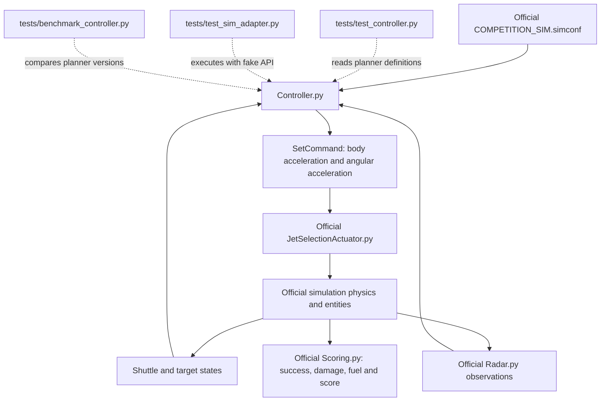

# Codebase guide: Escape from Phobos qualification controller

## 1. What this document does

`QUALIFICATION.md` is the project's developer guide. It explains the architecture,
algorithm, tests, tuning, and validation results. Space Teams PRO does not execute
or import this file. Editing a speed value in this document does not change the
rover's speed; executable settings are in `Controller.py`.

The simulator runs `Controller.py`. The `tests` folder helps us check that code
before a live run. `BasicController.py` and `UserAPI.py` are starter references.

## 2. What each file is for

| File | Role | Connection to the running controller |
| --- | --- | --- |
| `Controller.py` | Our complete autonomous controller: connection, radar interpretation, planning, translation, orientation, and logging. | The official competition configuration launches this file from `Local/Repos/STU4-Solution/Controller.py`. |
| `BasicController.py` | Official example showing basic target-seeking translation and target-facing rotation, plus camera examples. It does not contain our debris-avoidance planner. | `Controller.py` does not import or run it. A test reads its protected starter section to check that ours is preserved. |
| `UserAPI.py` | Example script illustrating simulator API calls, sensor access, cameras, and a simple body-axis acceleration command. | A reference, not a library imported by our controller. Check API examples against the installed simulator before copying them. |
| `tests/test_controller.py` | Unit tests and small closed-loop experiments for our planner and attitude function. | Reads selected definitions directly from `Controller.py`; it does not maintain a separate copy of the algorithm. |
| `tests/test_sim_adapter.py` | Checks the real controller's connection and main loop with a fake simulator API. | Executes `Controller.py` against mocked `spaceteams` objects, without launching Space Teams PRO. |
| `tests/benchmark_controller.py` | Compares the current planner with the planner from an earlier Git commit on repeatable synthetic routes. | Reads the current `Controller.py` and uses `git show` to read the baseline version. |
| `tests/benchmark_results.json` | Saved output from the benchmark: times, clearance, speed, translation effort, and planning latency. | Evidence from a past run. The controller never reads it, and it is not automatically refreshed after edits. |
| `README.md` | Original starter landing page and links to competition material. | Documentation only. |
| `QUALIFICATION.md` | This explanation and the validation/tuning record. | Documentation only. |

The live controller needs the simulator-provided `spaceteams` package and NumPy.
The tests are development tools; the live controller does not depend on them,
`BasicController.py`, or the benchmark JSON.

## 3. Architecture: where the code fits into the simulator



Our code asks for motion. The official simulator decides which jets fire, applies
physics, detects collisions, accumulates fuel/damage, and awards the score. We leave
those official systems unchanged. A successful offline test does not change or
override the official mission result.

`Controller.py` and `BasicController.py` are alternative executable scripts, not
parent and child classes. Keeping both files in the repository does not run two
controllers. The simulation configuration chooses the executable source file.

## 4. How one Python file contains the algorithm

One file can contain several functions, a class with persistent memory, and a main
loop. We kept them together so deploying the tested `Controller.py` also deploys
all of our algorithm's definitions; there are no extra project modules to copy.

Read the file from top to bottom in this order:

| Section or definition | Responsibility |
| --- | --- |
| Protected connection/helper section | Connects using `st.connect_to_sim(sys.argv)`, registers exception logging, gets entity/frame references, and defines the supplied helpers. Preserved from the starter. |
| Tuning constants | Set speed, acceleration, braking, feedback gain, planning interval, lookahead, and arrival offset. |
| `limit_vector()` | Caps vector magnitude while preserving direction. Used for bounded acceleration, rotation rate, and velocity candidates. |
| `attitude_command()` | Computes how to turn the rover so its front follows travel and its top remains locally upright. Returns body-frame angular acceleration. |
| `QualificationPlanner.__init__()` | Creates the planner's memory and deterministic direction samples. Called once at startup and again if simulation time moves backward. |
| `QualificationPlanner.obstacles()` | Turns delayed, noisy radar reports into predicted current obstacle centres, estimated velocities, and inflated collision radii. |
| `QualificationPlanner.command()` | Builds possible velocities, predicts their future trajectories, rejects unsafe choices, and selects the best remaining command. |
| Main `while True` loop | Reads state, periodically calls the planner, updates thrust and attitude commands each tick, and logs progress. |
| `finally` cleanup | Attempts to send zero linear/angular commands and leave the simulation when the script exits. |

The planner instance persists between loop iterations. Its important fields are:

| Field | Why it exists |
| --- | --- |
| `history` | Recent shuttle positions and velocities, used to interpret where the shuttle was when a radar measurement was made. |
| `report_cache` / `track_counter` | Cached observations and internally assigned track identities. Radar list indices can change when reports are sorted. |
| `previous_velocity` | The selected desired velocity. The fast control loop follows it between planning updates; the planner also discourages abrupt changes from it. |
| `approach_direction` | Locks the side from which the rover approaches its terminal holding waypoint. |
| `directions` | The 48 deterministic directions spread over a sphere, reused as avoidance alternatives. |
| `last_horizon` / `last_delta_v` | Diagnostics describing the last selected prediction. |

## 5. What happens during flight

The algorithm is a sampled local trajectory planner with a receding horizon,
followed by velocity feedback and attitude control. "Receding horizon" means it
predicts ahead, follows the selected choice briefly, then replans from new data.

### Step 1: read the state and validate radar

The main loop obtains shuttle position/velocity, target position/velocity, attitude,
and angular velocity. Navigation calculations use the Phobos-fixed frame. Radar
position vectors are relative to the shuttle but expressed in Phobos axes.

The runtime radar filter rejects malformed/non-finite reports, zero-length
positions, observations over 10 seconds old, and timestamps over 5 seconds ahead.
If no usable radar remains, `WAIT_RADAR` requests target-matching velocity, which
brakes a moving shuttle relative to the target. This does not promise position
holding or collision avoidance when the sensor is unavailable.

### Step 2: reconstruct and track obstacles

Each radar report supplies relative position, nearest-surface range, radial range
rate, diameter, and measurement time. The planner uses position, range rate,
diameter, and time; the nearest-surface range is not currently used in its collision
calculation.

`obstacles()` uses shuttle history to convert the measured relative position into
an approximate absolute position at measurement time. Range rate and shuttle
velocity give an estimate of the debris's absolute radial velocity. Unambiguous
matches with previous observations add a smoothed estimate of sideways velocity.
It then extrapolates each obstacle to the current time.

Repeated reports retain cached estimates rather than being treated as new samples.
Ambiguous matches keep a radial-only estimate. Inflated radii account for shuttle
size, diameter/position uncertainty, measurement age, and missing startup history.
These are approximations: radar does not provide stable object IDs or full velocity.

### Step 3: select a destination and a braking speed

The destination is an approach-side waypoint 45 m from the rescue ship centre.
Within 200 m of the ship, the planner locks the approach side. This keeps the
destination from continually moving around the ship as the rover maneuvers.

Let `d` be distance to that waypoint. The goal-relative speed is:

```text
speed = min(12, sqrt(2 × 0.12 × d), 0.4 × d) metres/second
desired velocity = target velocity + speed × direction to waypoint
```

The square-root term provides a stopping-distance envelope. The proportional term
smooths the last part of arrival. This is why changing only `MAX_SPEED` does not
make the rover travel at that speed everywhere.

### Step 4: generate alternatives

The planner considers up to 116 desired velocities:

- Goal guidance, target-matching velocity, the previous command, and coasting.
- Sixteen smaller steering changes around the goal direction: eight each at 12°
  and 25°.
- Forty-eight sphere directions at full allowed speed and again at half speed.

Previous/coasting velocities are also clipped to the current speed envelope so an
old cruise command cannot bypass terminal braking.

### Step 5: predict and check each trajectory

For each candidate, the planner simulates acceleration-limited motion in one-second
steps for 40–65 seconds. The goal candidate updates its braking guidance during
prediction; the other candidates follow their selected velocities.

For each step it checks the swept relative segment against moving, inflated debris
spheres. Checking the segment also catches predicted crossings between step
endpoints. Prediction uncertainty grows with lookahead time. Very distant obstacles
outside a conservative reachable region are filtered out to save computation.

The model is deliberately simpler than the full simulator: it does not reproduce
the jet allocator, full gravity field, detailed hulls, or actual attitude dynamics
inside each translational rollout.

### Step 6: choose a route

Candidates with positive predicted clearance are eligible. Among those, the cost is:

```text
predicted distance from the destination
+ 1.5 × change from the previous desired velocity
+ 1.5 × accumulated predicted acceleration magnitude
```

The last term approximates translation effort, encouraging fewer unnecessary burns.
It does not calculate actual fuel use or directly optimize the official score.
The coefficients are tuning weights, not physical constants.

If all candidates violate inflated boundaries, `ESCAPE` chooses the least
accumulated predicted penetration, with a small route-cost tie-break. It is an
emergency heuristic and cannot guarantee avoiding an impact.

### Step 7: convert the route into thruster requests

At most every 0.5 simulation seconds, planning updates `previous_velocity`. Every
control-loop tick, the velocity servo computes:

```text
acceleration in Phobos axes = 0.6 × (desired velocity − measured velocity)
```

It caps this acceleration at the lower of 0.30 m/s² and the configured actuator
limit. `FramedVector(..., phobosFrame).ExprIn(shuttleFrame)` converts the result
into body axes before `SetCommand()` writes it to the jet-selection parameters.

Separately, `attitude_command()` constructs an upright orientation with body +X
along travel and body +Z outward from Phobos. It computes orientation error,
requests a bounded turn rate, then requests bounded angular acceleration. It
handles vertical flight and a 180° upside-down start. Braking does not turn the
rover backward because heading follows travel, not acceleration.

The official jet allocator translates these requests into actual thruster action.
Translation is allowed during turns so orientation alignment cannot delay an
avoidance maneuver.

### Step 8: monitor arrival and official success

Controller modes are `GUIDE`, `AVOID`, `ESCAPE`, `WAIT_RADAR`, and `HOLD`. `HOLD`
means within 3 m of the holding waypoint with relative speed below 0.5 m/s; it
does not independently declare mission success. Position guidance keeps running.

Official `Scoring.py` declares success upon entering the configured safe sphere
(currently 50 m), provided the mission has not already failed from damage. Look
for its "Successfully escaped Phobos" alert. Our 45 m offset is guidance, not a
model of the ship's complete hull, so visual clearance still needs live validation.

## 6. How the tests connect to Controller.py

`test_controller.py` parses the real source using Python's AST (Abstract Syntax
Tree). It selects the constants, `limit_vector`, `attitude_command`, and
`QualificationPlanner`, and executes just those definitions. This avoids executing
the top-level `st.connect_to_sim()` call or the infinite runtime loop. The tests
therefore exercise the algorithm currently in the file without a simulator session.

Those tests feed synthetic states/radar to the planner, integrate simplified motion,
and assert results such as arrival, physical sphere clearance, bounded commands,
stable tracking after report reordering, braking, and attitude recovery. They also
read `BasicController.py` to compare the protected starter section. No test calls
the basic controller's navigation loop.

`test_sim_adapter.py` covers the surrounding wiring that AST extraction skips.
It installs a fake `spaceteams` module, replaces sleeping with a simulated clock,
and executes the entire real `Controller.py`. Fake entities return known states;
the fake API records commands. A controlled exception stops the infinite loop and
checks cleanup. It verifies connection, coordinate conversion, command limits,
missing/invalid radar behavior, and the attempt to send zero commands on shutdown.
It verifies our API usage against the double we wrote, not compatibility with every
behavior of the real installed API.

`benchmark_controller.py` asks a different question: how did this version compare
with an earlier version? It extracts both planners, runs fixed-seed routes, and
saves results to JSON. The baseline commit must exist locally, and rerunning the
benchmark overwrites its output file. The JSON stores the baseline reference and
current source hash so results can be tied to the versions that produced them.
The benchmark is a separate command; unittest discovery does not run it.

None of these tests sends commands to a live simulator. Passing them provides
evidence about code behavior in controlled cases, while your Space Teams PRO runs
provide evidence about actual mission performance.

## 7. Current tuning and validation record

| Setting in `Controller.py` | Current value | Effect |
| --- | ---: | --- |
| `MAX_SPEED` | 12 m/s | Caps desired target-relative cruise speed. |
| `MAX_ACCEL` | 0.30 m/s² | Caps requested translation and the acceleration used in rollouts. |
| `BRAKE_ACCEL` | 0.12 m/s² | Sets the stopping-distance speed envelope; it is not a separate thruster command. |
| `VELOCITY_GAIN` | 0.6 /s | Converts velocity error to requested acceleration. |
| `HORIZON` | 40 s | Minimum lookahead; the code extends it up to 65 seconds at higher current speed. |
| `PLAN_PERIOD` | 0.5 s | Minimum simulation-time interval between planning updates. |
| `HOLD_RADIUS` | 45 m | Offsets the destination from the rescue ship centre. |

These values interact. Raising cruise speed increases stopping distance and can
increase fuel demand; changing acceleration affects both prediction and commands.
After an algorithm/tuning edit, run the tests and benchmark, then validate in the
official simulator. Updating this table alone changes documentation, not behavior.

`Controller.py` is self-contained and keeps the original protected connection and
helper section. No STU4-Sim files or simulator configuration have been edited.

The controller uses target-relative velocity guidance (12 m/s cruise cap), slows near
the destination, and chooses among up to 116 candidate velocities with acceleration-limited
40–65-second rollouts. The lookahead covers nominal stopping time at the requested
0.30 m/s² acceleration plus 8 seconds, subject to the 65-second cap. Achieved thrust
can be lower than requested; the lookahead is not a stopping guarantee.
It checks swept segments against inflated radar spheres,
including a 3 m shuttle radius, measurement/diameter margins, and increasing drift
uncertainty. Planning runs at most twice per simulation second. Commands are
transformed from the Phobos frame into the shuttle frame. Attitude guidance turns
body +X (front) toward actual travel and body +Z (top) toward local outward/up.
At low speed it follows the planned travel direction, then retains heading while
holding. Rate and angular-acceleration limits make turns gradual. It recovers from
an upside-down attitude and handles vertical-flight singularities. Translation
remains independent during turns so attitude alignment cannot delay avoidance.
Status logs appear every
five simulation seconds. Blocking camera captures have been removed. A velocity
servo refreshes thrust every control tick between planning updates. Commands respect
the configured actuator limits. Missing, invalid, or more than 10-second-old radar
causes braking toward target velocity (`WAIT_RADAR`) rather than blind navigation.

Terminal guidance locks an approach-side waypoint 45 m from the rescue ship centre
inside the official 50 m success sphere. Its rollout includes braking toward that
waypoint. `HOLD` indicates it is within 3 m of the waypoint with relative speed below
0.5 m/s; this is controller telemetry, not the official success alert. It continues
active position guidance after arrival instead of flying toward the ship centre.
The ship's full hull geometry is not supplied to the planner, so the offset still
needs visual verification in the simulator. A 12 m/s cap does not imply constant
12 m/s flight: acceleration, braking and obstacle avoidance reduce speed as needed.
Braking guidance retains the conservative 0.12 m/s² stopping-distance parameter.
Previously selected velocities and coasting choices are capped by the current
terminal speed envelope so they cannot bypass approach braking.

The FAST12 profile adds 12° and 25° steering alternatives near the goal direction
and an explicit coasting candidate. It penalizes accumulated predicted acceleration
(a translation-impulse proxy) and changes of velocity command to discourage
unnecessary burns and abrupt route switching. Collision constraints take priority
over these costs. `profile=FAST12`, `lookahead`, `planDV`, and `cmdAccel` in status
logs identify the version and requested maneuver; `planDV` is neither measured
fuel nor the total run's delta-v.

Radar timestamps are referenced to Radar.py startup. The controller approximates
that epoch with its own startup clock and reconstructs shuttle motion from history.
Successive reports are associated using predicted absolute position, timestamp,
and diameter, independent of radar ordering. Unambiguous matches estimate transverse
velocity with a low-pass filter; ambiguous matches retain a radial-only estimate.
Repeated reports are cached without treating them as fresh measurements. Prediction
margins grow by 1 m per second of measurement age and lookahead time.
Startup skew, association errors, unobserved transverse debris velocity, gravity,
and actual jet allocation remain sources of prediction error. Margins are heuristics,
not collision guarantees.
`ESCAPE` means every sampled trajectory intersected an inflated obstacle; it chooses
the least accumulated predicted penetration, allowing it to leave overlapping
uncertainty margins. Local planning can stall in dense fields.

### Offline validation

With Python and NumPy installed:

```powershell
python -m unittest discover -s tests -v
```

Twenty tests cover clear-route arrival, complete static-obstacle avoidance,
immediate obstacle response, stale measurement correction, transverse tracking,
radar reordering, repeated reports, escape from inflated overlap, fast incoming
debris, and preservation of the protected boilerplate. Three fixed-seed crossing
scenarios include 2 m position noise, noisy range rate/diameter, 1.5-second radar
updates, moving obstacles, a small gravity disturbance, and 10% thrust under-delivery.
Each enters a 48 m arrival threshold without physical-sphere contact. Additional
tests integrate attitude dynamics through a 90-degree turn and a 180-degree
upside-down recovery, check stationary/vertical guidance, and run a 1 km route
through arrival and prolonged holding with 10% thrust under-delivery. That route
exceeds 11 m/s, stays outside 40 m after arrival, and settles near the 45 m waypoint.
Additional checks cover high-speed lookahead and retained-command terminal braking.

Planner tests extract pure code using AST. Adapter tests execute the actual
controller against a mock Space Teams API and check a rotated body frame, command
limits, missing/invalid radar, connection, and zero-command cleanup. No tests connect
to Space Teams PRO. These simplified dynamics and API doubles do not reproduce the
real allocator, collisions, irregular geometry, or complete gravity field. Passing
is not qualification proof.

### Speed comparison

The user's latest live baseline was 195.98 s, 117.34 kg fuel, zero damage, score
−45.2. FAST12 has not yet been tested in Space Teams PRO.

Reproduce the synthetic comparison against the prior 10 m/s controller:

```powershell
python tests/benchmark_controller.py --baseline-ref 74f9f06f07fc47e412ac7d2e8cf52fb332f59cfb
```

Results are saved to `tests/benchmark_results.json`. Routes are 1305.8 m long;
cluttered cases use eight moving spheres, noisy 1.5-second radar updates, gravity
disturbance, and either 90% or 65% thrust delivery. All six compared runs arrived;
the cluttered runs retained positive physical sphere clearance.

| Synthetic case | Previous time | FAST12 time | Previous translation delta-v | FAST12 delta-v |
| --- | ---: | ---: | ---: | ---: |
| Clear, 90% thrust | 172.0 s | 164.0 s | 19.16 m/s | 22.75 m/s |
| Clutter seed 7, 90% thrust | 182.0 s | 165.5 s | 32.71 m/s | 27.09 m/s |
| Clutter seed 19, 65% thrust | 183.5 s | 174.5 s | 24.06 m/s | 27.05 m/s |

Higher speed improved time in these cases but increased translation effort in two
of them. This benchmark omits attitude fuel, real jet allocation and full hull
geometry, so it does not predict the official score or guarantee lower fuel use.
For the next live run, compare time, fuel, damage and score together against the
195.98 s / 117.34 kg / zero-damage baseline. Retain a higher-speed profile only if
the repeated simulator results justify the tradeoff.

### Required Space Teams PRO validation

1. Back up the installed `Local/Repos/STU4-Solution/Controller.py`, then copy this
   repository's `Controller.py` there. Keep the installed folder named
   `STU4-Solution`: the official configuration references that exact path.
2. Launch the official `STU4-Sim/Sims/COMPETITION_SIM.simconf` in Space Teams PRO.
   Confirm the `IGNITION` status log appears and no Python/allocator errors occur.
3. Check distance falls, body-frame thrust responds correctly at different
   orientations, the front faces travel, the top stays upright relative to Phobos,
   angular rates settle, and radar clearance behaves plausibly. Confirm `HOLD`
   occurs near 45 m after the official success alert, without touching the ship.
   Check planning latency with the actual simulator running.
4. Run the official environment repeatedly. Record the simulator's success/failure,
   score, elapsed time, damage, fuel, and any sustained `ESCAPE`/stalled behavior.
   The official scoring system alone decides success (currently a 50 m safe sphere).
5. Tune the speed/acceleration and uncertainty margins only after inspecting those
   runs. Capture the required submission evidence and freeze the tested controller.

No live simulator run or qualification success has been verified in this change.
The baseline does not alter scoring, debris entities, or the official simulation.
