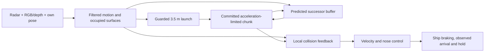

> **Historical document — archived 21 November 2026.**
> This describes an earlier revision or experiment. For the delivered implementation, see
> [Final Submission Algorithm](../Final%20Submission%20Algorithm.md). Archived commands and flags refer to their historical revision.
> Original location: `CHUNK_NAVIGATION.md`.

# Rolling chunk controller: CHUNK_NAV_12

> Historical version. The active source now uses **SCORE_ECO** with score-based
> burn/coast selection, overlapping chunks and a guarded arrival pass.
> See [SCORE_ECO.md](SCORE_ECO.md) for current validation and deployment.

This implements the proposed short launch followed by predicted, overlapping
route chunks in `Controller.py`. Run **FINAL_SUBMISSION.simconf**. The protected
connection helpers, `BasicController.py`, `UserAPI.py` and official STU4-Sim are
unchanged. `camera_viewer.py` remains the optional RGB/depth interface.

## What the supplied live log established

`261112_121154_FINAL_SUBMISSION__875` completed at **380.71 s**, with **0 J damage**,
**218.71 kg fuel**, distance **49.99 m**, and score **-210.1**. The station collision
was avoided in this run. Slow progress, frequent route changes and large nose
errors during the first half consumed time and fuel. The disconnect recorded
later does not undo the success already recorded by Scoring; the log alone does
not establish why that process disconnected.

## Algorithm

1. **Guarded launch:** request a climb of **3.5 m** along local planet-up, capped at
   0.9 m/s. Radar and camera collision checks remain active. If blocked, slide
   sideways or wait; the launch candidate set excludes downward escape into the
   starting terrain. A lateral avoidance move does not pull the launch goal back
   toward the original blocked column. Completing the lift releases cruise
   without requiring a stop. Missing radar and depth still cause a sensor wait.
2. **Estimate debris motion:** correct each radar report for own motion and its
   timestamp. Associate tracks without relying on sorted list indices. Fit
   transverse velocity using up to eight observations over 30 s and correct its
   radial component using measured Doppler/range rate. Predict `position + time *
   velocity` with inflated bounds. One radar snapshot supplies radial velocity,
   not a complete 3-D trajectory; prediction improves over successive sweeps.
3. **Build a flyable chunk:** search in both position and velocity using a bounded
   beam of motion primitives. Four stages, 13 branches and up to eight distinct
   trajectories keep the search finite. Each trajectory is integrated with a
   0.11 m/s² model acceleration and swept collision checks against debris at the
   corresponding future times. The nominal horizon is 32–60 s, shortened near the
   standoff goal. Chunks therefore cover different distances as speed changes.
   Stopping guidance is applied inside the forecast, not only after flying it.
4. **Prepare successors early:** retain the committed curve while it remains
   clear, and predict the next from its endpoint **and exit velocity**. Normally
   one successor is enough. A second can be prepared when the stopping distance
   requires more clear space. This is a bounded rolling buffer, not an initial
   route from spawn to destination. High speed necessarily requires looking far
   enough ahead to brake.
5. **Pass through boundaries:** steering looks ahead along the curve and into its
   successor. There is no stop command at ordinary chunk boundaries. Preserve
   curve timestamps and align the forecast to measured progress; do not treat a
   nearby future waypoint as already passed. The available verified buffer limits
   speed if another safe chunk cannot be prepared.
6. **Close the feedback loop:** check the committed and queued curves against new
   observations about once a second. Rebuild when a predicted crossing blocks
   them, the rover leaves the curve by more than 25 m, or the destination changes.
   Rising measured damage also invalidates cached predictions. Damage is a
   post-impact signal; geometric prediction is what attempts to prevent impact.
   At 2 Hz, independent short local rollouts can override the chunk for a hazard.
   When the guided rollout is safe, follow the committed chunk rather than switch
   directions for a small predicted progress difference.
7. **Finish at the scoring boundary:** keep routing around debris while braking,
   then use the ship depth observations to select a clear approach from the
   standoff toward **49 m**. Survey another side when blocked, reacquire the ship
   with a body turn if its bearing leaves the camera coverage, and hold position
   after arrival. The controller does not generate the congratulations message;
   the official scorer does that when its success condition is reached.



RGB contributes visual bearings/associations; depth contributes occupied geometry,
including objects absent from radar. Sensor failures and stale images remain
visible in the GUI/log. The same asynchronous capture and pose validation are
retained. The controller never reads hidden debris entity positions; ground truth
from the public scene is used only by the offline test harness.

## Speed, fuel and orientation

**`CHUNK_CRUISE_SPEED = 12 m/s`** is the requested cruise. The hard speed ceiling
remains 25 m/s; local hazards, curve geometry, clear-buffer length and terminal
braking determine the actual speed. The aim is to enable 10+ m/s where feasible,
not force that speed through an unsafe passage.

The final scenario permits a 0.5 m/s² translation command, which the controller
also clamps to the live vehicle limit. The installed jet allocator delivers less
than the command depending on direction and simultaneous torque. Ship braking
uses 0.075 m/s² plus an advance allowance. From 10 m/s, the modeled stopping
distance alone is about **667 m**. A 12 m/s command cannot be interpreted as a
promise of a sustained 12 m/s flight over this approximately 1,306 m mission.

Nose control still follows actual flight direction, allowing the steep climb the
user selected. Its angular rate now respects an estimated stopping angle, capped
at 0.075 rad/s, instead of requesting a 0.2 rad/s turn that can overshoot under the
shared jet allocator. Small velocity/attitude errors retain coasting bands.

## Validation and deployment

Run the unit, camera/GUI and actual-loop adapter checks with:

```powershell
python -B -m unittest discover -s tests -v
```

`tests/test_rolling_chunks.py` covers moving crossings versus departing objects,
time-indexed forecasts, flyable avoidance, early successor preparation,
pass-through steering, route retention, damage invalidation, launch height,
terrain-safe launch avoidance and future waypoint timing. Older navigation,
noisy/delayed radar, camera failure, coordinate conversion, nose and GUI checks
remain in the suite. Navigation-only fixtures disable launch explicitly; the
actual runtime adapter and full-flight benchmark execute it.

The final-scene benchmark uses 500 public-scene objects, noisy cycling radar,
delayed synthetic camera images, official jet geometry, approximate gravity and
an **ellipsoid proxy ship hull**. It cannot certify the real collision mesh or
official score. It runs another 30 s after arrival to check holding behavior.
Source/scenario hashes identify each result. Current chunk results are saved in
`tests/chunk_results.json` and `tests/chunk_seed101_results.json`; earlier
`final_submission_*` results belong to the previous standoff controller.

All **67 tests** pass. Both final-scene model runs reached the scoring boundary
without modeled debris or proxy-hull contact and held for another 30 s:

| Noise seed | Time | Fuel at arrival | Peak speed | Entry speed | Estimated zero-damage score |
| --- | ---: | ---: | ---: | ---: | ---: |
| 100 | 405.9 s | 225.22 kg | 8.88 m/s | 0.28 m/s | -220.73 |
| 101 | 388.1 s | 189.13 kg | 8.86 m/s | 0.58 m/s | -171.25 |

The results are mixed relative to the earlier standoff model: seed 100 is slower
and uses more fuel; seed 101 uses less fuel with similar duration. End-to-end
average progress remains about 3.1–3.3 m/s because launch, braking and station
survey take time. **10+ m/s and a consistent score improvement have not been
demonstrated in the actual 500-debris scene.** Earlier intermediate runs with
different timing logic had better model scores; those are not the final source's
validation. Native testing of this version is still required, especially for the
real ship hull and depth calibration. The supplied live -210.1 score belongs to
the previous controller.

The separate clear-corridor diagnostic also completed and held without modeled
contact, peaking at **9.67 m/s**. It caught a terminal handoff deadlock near 122 m;
the fix and its regression test are included. This diagnostic changes the debris
field in memory, so its speed is not a result for the official final scene.

```powershell
python -B tests/benchmark_final_submission.py --sim-config "path\to\STU4-Sim\Sims\FINAL_SUBMISSION.simconf" --jet-config "path\to\STU4-Sim\Data\SpaceBuggyJetConfigNoMains.csv" --output tests/chunk_results.json
```

For the second case, add `--seed 101 --output tests/chunk_seed101_results.json`.
`--clear-corridor` is a separate diagnostic that moves debris aside **in memory**
without editing the official scenario. It is not a competition-scene result.

Copy `Controller.py` and `camera_viewer.py` to the installed `STU4-Solution`
repository, then run **FINAL_SUBMISSION.simconf**. Verify **`profile=CHUNK_NAV_12`**.
The log now includes `chunk`, `nextReady`, `buffer`, `replans` and `launchHeight`,
alongside speed, damage, fuel, camera health and nose error. Persistent replans,
sensor waits or a short buffer explain reduced speed. Preserve those fields and
the full official scoring statistics for the next native run.
